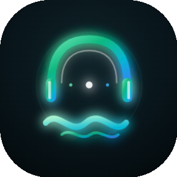
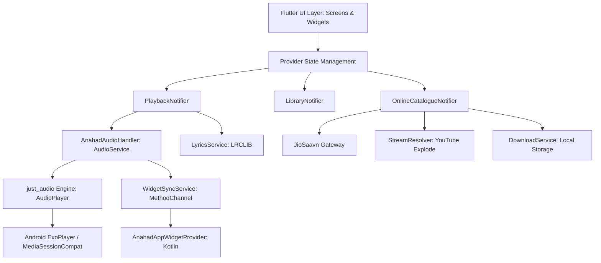

# ANAHAD (अनहद) — Hi-Res Music Player for Android

<p align="center">
  
</p>

<p align="center">
  <b>Audiophile Sound Quality • Zero Telemetry • Local-First Architecture • Indian Regional Music</b>
</p>

<p align="center">
  <a href="#features"></a>
  <a href="#technical-stack"></a>
  <a href="#privacy-overview"></a>
  <a href="#licensing"></a>
</p>

---

## 1. Introduction & Philosophy

**ANAHAD** (Sanskrit: *अनहद*, referring to boundless, unstruck celestial sound) is an independent, privacy-first audio player engineered for Android. 

Designed for music lovers who appreciate clean design, audiophile fidelity, and total personal privacy, ANAHAD merges:
- **Aesthetic Elegance**: Minimalist layout inspired by Apple Music's card hierarchy and blur styling.
- **Catalogue & Language Discovery**: Indian regional language hubs (Hindi, Punjabi, Gujarati, Marathi, Rajasthani, Telugu, Tamil, and more) inspired by Gaana.
- **Audio Fidelity**: High-resolution lossless audio detection (FLAC, ALAC, WAV, 24-bit/96kHz / 192kHz) and format badges inspired by Poweramp.
- **Local-First Privacy**: **Zero tracking, zero analytics SDKs, zero ads, zero user accounts**, and local storage isolation.

---

## 2. Key Features

- **High-Resolution Lossless Playback**: Native decoding of FLAC, ALAC, WAV, OGG, M4A, and MP3 via an asynchronous playback pipeline.
- **Audiophile Format Badges**: Visual indicators for `FLAC`, `HI-RES LOSSLESS (24B/96kHz)`, `AAC 320K`, and `MP3` displayed across tracks, now-playing screens, and mini-players.
- **Offline Device Library**: Automatic indexing of local audio files via Android MediaStore with instant search, sorting, and playlist organization.
- **Online Catalogue Discovery**: Client-side search for tracks, albums, and featured artists across public web gateways (JioSaavn) with YouTube audio fallback resolution.
- **Indian Regional Language Hubs**: Instant access to regional music hubs covering 12 languages with native scripts and curated search queries.
- **Synchronized Karaoke Lyrics**: Timestamped `.lrc` lyrics parsing via LRCLIB and fallback endpoints with auto-scroll and tap-to-seek functionality.
- **Global "Air Shuffle"**: Context-aware shuffle button providing seamless playback matching the active screen view (Offline, Search, Language, Trending).
- **Download & Storage Manager**: Parallel background downloader with customizable save destinations (`App Storage`, `/Music/ANAHAD`, `/Download/ANAHAD`, or Custom Path) and automatic `.lrc` lyrics bundling.
- **Android Home Screen Widget**: Native Kotlin `AnahadAppWidgetProvider` featuring live track metadata, artwork, lyrics preview, and playback controls.
- **Lock-Screen & Notification Media Session**: Seamless background playback with Android `MediaBrowserService` and `MediaSessionCompat`.
- **Theming & Customization**: Obsidian Dark, AMOLED Pure Black, and Apple-inspired Light themes paired with a customizable accent color palette.
- **Backup & Restore**: Simple JSON export and import for user playlists, favorites, and player preferences without cloud dependencies.

---

## 3. Screenshots & Visual Interface

| Home & Regional Music | Now Playing & Lossless Badges | Search & History | Settings & Legal Hub |
|---|---|---|---|
| *(assets/screenshots/home.png)* | *(assets/screenshots/now_playing.png)* | *(assets/screenshots/search.png)* | *(assets/screenshots/settings.png)* |

*(High-resolution screenshots are available in `/marketing/` and `docs/`)*

---

## 4. Technical Stack

- **Framework**: Flutter 3.27.x / Dart 3.6+
- **Native Android**: Kotlin 2.1, Gradle 8.9, Java 17
- **Audio Pipeline**: `just_audio` (0.9.46) + `audio_service` (0.18.19)
- **Local Media Indexing**: `on_audio_query` (2.9.0)
- **State Management**: `provider` (6.1.5)
- **Local Storage**: `shared_preferences` (2.5.3) + `path_provider` (2.1.5)
- **Network & Cryptography**: `http` (1.6.0), `dart_des` (1.0.2), `youtube_explode_dart` (3.1.0)

---

## 5. Technical Architecture



---

## 6. Installation & Build Instructions

### Prerequisites
- Flutter SDK (>= 3.27.0)
- Android SDK (compileSdk 34, targetSdk 34, minSdk 21)
- JDK 17

### Building from Source

1. Clone the repository:
   ```bash
   git clone https://github.com/[username]/anahad.git
   cd anahad
   ```

2. Fetch dependencies:
   ```bash
   flutter pub get
   ```

3. Run static analysis and unit tests:
   ```bash
   flutter analyze
   flutter test
   ```

4. Build the Release APK:
   ```bash
   flutter build apk --release
   ```
   The compiled APK will be located at `build/app/outputs/flutter-apk/app-release.apk`.

---

## 7. Android Compatibility

- **Minimum Android Version**: Android 5.0 (API Level 21)
- **Target Android Version**: Android 14 (API Level 34)
- **Architectures**: `arm64-v8a`, `armeabi-v7a`, `x86_64`

---

## 8. Privacy Overview & Zero Telemetry

ANAHAD adheres strictly to **Privacy-by-Design**:
- **No User Registration**: No emails, passwords, phone numbers, or social sign-in.
- **Zero Third-Party SDKs**: No Google Analytics for Firebase, Crashlytics, Facebook SDK, or ad networks.
- **Local Sandboxing**: Playlists, favorites, listening history, and preferences remain solely on your local device.
- For complete details, consult our [Data Inventory](documentation/privacy/DATA_INVENTORY.md) and [Privacy Policy](legal/PRIVACY_POLICY.md).

---

## 9. Permissions Explanation

| Permission | Android Level | Reason for Use |
|---|---|---|
| `READ_MEDIA_AUDIO` | Android 13+ (API 33+) | Access device audio files for local library playback. |
| `READ_EXTERNAL_STORAGE` | Android 12 and below | Access device audio files on legacy Android versions. |
| `FOREGROUND_SERVICE` | All versions | Ensure smooth background playback when screen is off. |
| `FOREGROUND_SERVICE_MEDIA_PLAYBACK` | Android 14+ (API 34) | Explicit foreground media service declaration. |
| `WAKE_LOCK` | All versions | Prevent CPU throttling during active music playback. |
| `POST_NOTIFICATIONS` | Android 13+ (API 33+) | Display notification shade and lock-screen media player. |
| `INTERNET` | All versions | Stream online catalogue music, fetch lyrics, and download artwork. |

---

## 10. Legal Documentation & Disclaimers

- [Terms of Service](legal/TERMS_OF_SERVICE.md)
- [Privacy Policy](legal/PRIVACY_POLICY.md)
- [Legal Disclaimer](legal/DISCLAIMER.md)
- [Copyright & Intellectual Property](legal/COPYRIGHT_AND_INTELLECTUAL_PROPERTY.md)
- [Third-Party Licenses & Notices](legal/THIRD_PARTY_NOTICES.md)
- [Acceptable Use Policy](legal/ACCEPTABLE_USE_POLICY.md)

**Notice**: ANAHAD is an independent audio player tool. Users are responsible for having appropriate legal rights and permissions for any sound recordings accessed, played, or downloaded using the Application.

---

## 11. Known Limitations & Roadmap

- **Equalizer Hardware DSP**: Equalizer preset curves are stored and visualized in settings; native low-level DSP hardware effects binding is in progress.
- **Lock-Screen Lyrics**: Lock-screen custom overlays are restricted on Android 11+ due to Android OS security policies; lyrics are viewable on the widget and in-app.
- **Third-Party Uptime**: Online catalogue availability relies on third-party web gateways that operate independently.

---

## 12. License & Intellectual Property

- Application source code and branding are copyright © 2026 [Maintainer Name / Independent Developer].
- Open-source license selection is currently pending maintainer approval (see [LICENSE_COMPARISON.md](LICENSE_COMPARISON.md) for options).
- All third-party software packages are governed by their respective licenses in [legal/THIRD_PARTY_NOTICES.md](legal/THIRD_PARTY_NOTICES.md).
