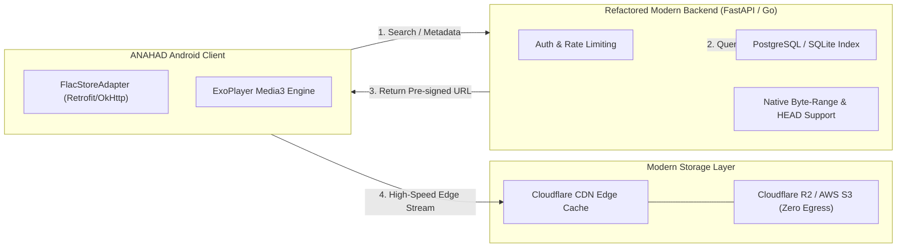

# ANAHAD: Music Source Subsystem & Adapter Architecture

- **Document Version**: 1.0.0
- **Status**: Approved Architectural Blueprint
- **Author**: ANAHAD Senior Engineering Architecture (Ponytail)
- **Target Platform**: Android (Kotlin / Jetpack Compose / Media3 ExoPlayer)

---

## 1. Architectural Philosophy: Decoupled Ports & Adapters

ANAHAD is architected using **Clean Architecture** and the **Ports-and-Adapters (Hexagonal)** pattern. The fundamental design invariant is:

> **Core Invariant**: The local audio player, playback engine, playlist manager, favourites store, lyrics parser, and backup/restore subsystem must have **zero compile-time or runtime dependency** on any specific online music store, remote API, or proprietary cloud storage provider.

Audio tracks are represented as unified domain entities. The player operates on standard media URIs (`file://`, `content://`, or authenticated `https://`), completely agnostic of whether a track resides in the device's flash memory, an offline cache, a personal self-hosted media server, or a remote streaming provider.

```mermaid
flowchart TD
    subgraph UI_Layer["UI & Presentation (Jetpack Compose)"]
        UI["Now Playing / Library / Search / Playlists"]
    end

    subgraph Core_Domain["Core Domain & Application Layer"]
        PlayerEngine["Playback Engine (Media3 / AudioTrack)"]
        LibraryManager["Local Library Manager (Room DB)"]
        PlaylistManager["Playlist & Favourites Manager"]
        LyricsEngine["Lyrics Synchronization Engine"]
        DownloadEngine["Resumable Download Manager"]
    end

    subgraph Ports["Ports (Domain Interfaces)"]
        IMusicSource["IMusicCatalogSource"]
        IStreamingSource["IStreamingSource"]
        IDownloadSource["IDownloadSource"]
    end

    subgraph Adapters["Adapters (Infrastructure Layer)"]
        LocalAdapter["Local MediaStore Adapter"]
        SubsonicAdapter["OpenSubsonic / Navidrome Adapter"]
        S3Adapter["S3 / Cloudflare R2 Direct Adapter"]
        FlacStoreAdapter["FLAC Music Store Adapter (Refactored)"]
        CCArchiveAdapter["Internet Archive / CC Adapter"]
    end

    UI --> PlayerEngine
    UI --> LibraryManager
    UI --> PlaylistManager
    UI --> LyricsEngine
    UI --> DownloadEngine

    PlayerEngine --> Ports
    LibraryManager --> Ports
    DownloadEngine --> Ports

    IMusicSource <|.. LocalAdapter
    IMusicSource <|.. SubsonicAdapter
    IMusicSource <|.. S3Adapter
    IMusicSource <|.. FlacStoreAdapter
    IMusicSource <|.. CCArchiveAdapter
```

---

## 2. Domain Interface Contracts (The Ports)

The domain layer defines pure Kotlin interfaces for remote catalog discovery, streaming, and downloading:

### 2.1 Unified Track Entity
```kotlin
package com.anahad.core.domain.model

data class Track(
    val id: String,                         // Global unique ID (e.g. trk_uuid)
    val sourceId: String,                   // Provider-specific ID
    val sourceProvider: SourceProvider,     // LOCAL, SUBSONIC, S3, OPEN_ARCHIVE
    val title: String,
    val artist: ArtistSummary,
    val album: AlbumSummary,
    val durationMs: Long,
    val trackNumber: Int? = null,
    val discNumber: Int? = null,
    val genre: String? = null,
    val year: Int? = null,
    val audioProfile: AudioProfile,
    val artworkUri: String? = null,
    val playbackUri: String,                // URI used by ExoPlayer
    val isDownloaded: Boolean = false,
    val localFilePath: String? = null
)

data class AudioProfile(
    val format: AudioFormat,                // FLAC, WAV, ALAC, MP3, OPUS
    val sampleRateHz: Int,                  // e.g. 44100, 96000
    val bitDepth: Int,                      // e.g. 16, 24
    val channels: Int,                      // 1 = Mono, 2 = Stereo
    val bitrateKbps: Int? = null,
    val fileSizeBytes: Long,
    val checksumMd5: String? = null,
    val isLossless: Boolean = true,
    val isHiRes: Boolean = bitDepth > 16 || sampleRateHz > 44100
)

enum class AudioFormat { FLAC, WAV, ALAC, MP3, OPUS, AAC }
enum class SourceProvider { LOCAL, SUBSONIC, S3, FLAC_STORE, OPEN_ARCHIVE }
```

### 2.2 Source Interface Definitions
```kotlin
package com.anahad.core.domain.port

import com.anahad.core.domain.model.*
import kotlinx.coroutines.flow.Flow

interface IMusicCatalogSource {
    val provider: SourceProvider
    
    suspend fun search(
        query: String,
        page: Int = 1,
        pageSize: Int = 25,
        filter: SearchFilter? = null
    ): Result<PagedResult<Track>>

    suspend fun getTrackDetails(trackId: String): Result<Track>
    
    suspend fun getStreamDescriptor(trackId: String): Result<StreamDescriptor>
    
    suspend fun getDownloadDescriptor(trackId: String): Result<DownloadDescriptor>
}

data class StreamDescriptor(
    val streamUri: String,
    val headers: Map<String, String> = emptyMap(),
    val supportsRangeRequests: Boolean = true,
    val estimatedLengthBytes: Long
)

data class DownloadDescriptor(
    val downloadUri: String,
    val suggestedFilename: String,
    val headers: Map<String, String> = emptyMap(),
    val fileSizeBytes: Long,
    val expectedChecksumMd5: String? = null,
    val expectedChecksumSha256: String? = null
)
```

---

## 3. Decoupled Subsystem Boundaries

The ANAHAD architecture isolates each major system capability:

### 3.1 Local Library Subsystem
- **Responsibility**: Scans local storage using Android `MediaStore`, parses embedded FLAC metadata (Vorbis comments) and album art using native C++ `libflac` / `TagLib`, and stores the relational index in **Room (SQLite)**.
- **Isolation**: Has zero awareness of remote APIs. Remote tracks become part of the local library only when explicitly downloaded and saved to disk.

### 3.2 Playback Engine Subsystem
- **Responsibility**: Manages playback state, queue scheduling, audio focus, notification media controls, and hardware DAC output.
- **Tech Stack**: Built upon `androidx.media3.exoplayer` wrapped in a foreground `MediaSessionService`.
- **Audio Routing**: Configures `AudioTrack` with `AudioAttributes.CONTENT_TYPE_MUSIC` and `USAGE_MEDIA`. Automatically activates bit-perfect USB DAC pass-through when an external DAC is detected.
- **Buffering**: Progressive HTTP caching is handled by Media3's `CacheDataSource.Factory` using an LRU disk cache, completely decoupled from any specific streaming backend.

### 3.3 Download Engine Subsystem
- **Responsibility**: Manages foreground and background track downloads, network condition constraints (e.g. Wi-Fi only), paused/resumed downloads, and post-download hash verification.
- **Implementation**: Uses a robust OkHttp range-download pipeline with a foreground Android `WorkManager` worker. Interrupted downloads resume from the last byte received using HTTP `Range: bytes={downloadedBytes}-`.
- **Hash Integrity**: Upon download completion, the engine computes the MD5/SHA-256 of the downloaded file and verifies it against `DownloadDescriptor.expectedChecksumMd5` before committing the file to the local library.

### 3.4 Playlists & Favourites Subsystem
- **Responsibility**: Allows users to organize tracks into custom playlists and mark favorites.
- **Design Rule**: Tracks in playlists are referenced by a uniform `track_uri`. A playlist can hold a mix of local and remote tracks seamlessly without coupling to the remote catalog.

### 3.5 Lyrics & Metadata Enrichment
- **Responsibility**: Extracts synchronized `.lrc` lyrics from embedded FLAC Vorbis comment tags (`LYRICS`, `UNSYNCEDLYRICS`) or matches against local companion `.lrc` files.
- **Isolation**: Remote lyrics fetching (e.g. LRCLIB API) operates as an independent optional metadata plugin.

---

## 4. Specifications for Modifying the FLAC Music Store (Scenario B)

If the `Thepathakarpit/flacmusicstore` concept were to be adapted for a legal, production-ready implementation, the following architectural overhaul is required:



### 4.1 Storage Layer: Migrate from Google Drive to S3 / Cloudflare R2
1. **Eliminate Google Drive**: Cease using Google Drive export links.
2. **Adopt S3 / Cloudflare R2**: Store FLAC files in an S3-compatible bucket. Cloudflare R2 provides **zero egress fees**, eliminating bandwidth costs for large FLAC files.
3. **Pre-signed Streaming URLs**: The backend does not proxy the heavy audio bytes. Instead, it generates short-lived pre-signed URLs (e.g. valid for 1 hour) pointing directly to the CDN edge.
4. **Instant Seeking (<100ms)**: Cloudflare edge nodes natively support RFC 7233 range requests, dropping seek latency from **7.95 seconds** to **under 100 milliseconds**.

### 4.2 Database & Metadata: Replace CSV with SQLite / PostgreSQL
1. **Schema Migration**: Store metadata in a structured relational database with an indexing schema covering `title`, `artist`, `album`, `genre`, `year`, `sample_rate`, `bit_depth`, `channels`, `duration_ms`, `file_size_bytes`, `sha256_checksum`, and `artwork_url`.
2. **Eliminate Pandas & Heavy Binaries**: Replace Pandas/NumPy with native SQLAlchemy / SQL queries.
3. **Automated Metadata Ingestion**: Ingest FLAC Vorbis comments automatically upon upload using `mutagen.flac.FLAC`, extracting true track numbers, disc numbers, and audio properties directly from audio headers rather than filenames.

### 4.3 Backend Security & Caching Overhaul
1. **Input Validation**: Enforce strict alphanumeric track ID validation (`^[a-zA-Z0-9_-]{12,64}$`) to prevent arbitrary file access or IDOR.
2. **Sanitize Filenames**: Apply `secure_filename()` to all file operations.
3. **Eliminate Unbounded Server-Side Download Caches**: When using pre-signed S3 URLs, the backend never downloads files to its local disk, eliminating disk exhaustion vulnerabilities.
4. **RFC 7807 Standardized Errors**: Return structured error payloads without exposing internal paths or Python traceback frames.

---

## 5. Alternative Open-Source Implementations & Ecosystem Research

Rather than maintaining a custom music server, the following proven open-source solutions provide superior capabilities:

### 5.1 OpenSubsonic / Subsonic API (Navidrome / Gonic / LMS)
- **What It Is**: An open, widely adopted REST specification for personal audio streaming supported by dozens of open-source server implementations.
- **Why It Excels**:
  - Native support for bit-perfect FLAC streaming, transcoding on demand (if requested by low-bandwidth connections), and cover art retrieval.
  - Built-in multi-user authentication, playlists, favorites, and scrobbling.
  - Battle-tested mobile client ecosystem.
- **Adoption for ANAHAD**: ANAHAD should implement an `OpenSubsonicAdapter` out of the box, allowing users to connect their own self-hosted Navidrome or Jellyfin servers immediately.

### 5.2 Direct S3 / Cloudflare R2 Bucket Adapter
- **What It Is**: A lightweight client adapter that reads an encrypted or public `catalog.json` from an S3 bucket and streams tracks directly via CDN.
- **Why It Excels**: Zero server maintenance, serverless scalability, low cost, and reliable edge caching.

### 5.3 Open Legal Music APIs
- **Internet Archive Live Music Archive (LMA)**: Provides legal, freely streamable lossless audio for thousands of live concerts.
- **Free Music Archive (FMA) API**: Curated independent music released under Creative Commons licenses.
- **MusicBrainz / ListenBrainz API**: Free, community-driven metadata catalog for tagging, cover art (Cover Art Archive), and acoustic fingerprinting.

---

## 6. Implementation Plan for ANAHAD

1. **Step 1: Local Player Core (Phase 1)**
   - Build the local playback engine, MediaStore scanner, Room database, and Jetpack Compose UI.
   - Establish the `IMusicCatalogSource` port interface.
2. **Step 2: Subsonic / OpenSubsonic Adapter (Phase 2)**
   - Implement `OpenSubsonicAdapter` as the first remote streaming adapter. This gives users immediate access to their personal FLAC libraries legally and securely.
3. **Step 3: Open Archive / Creative Commons Adapter (Phase 3)**
   - Implement an adapter for the Internet Archive or Free Music Archive for out-of-the-box legal music discovery.
4. **Step 4: Custom Cloud Adapter (Optional Future Extension)**
   - If an official ANAHAD online store is commissioned in the future, implement a dedicated S3/R2-backed service following the refactored architecture specified in Section 4.
