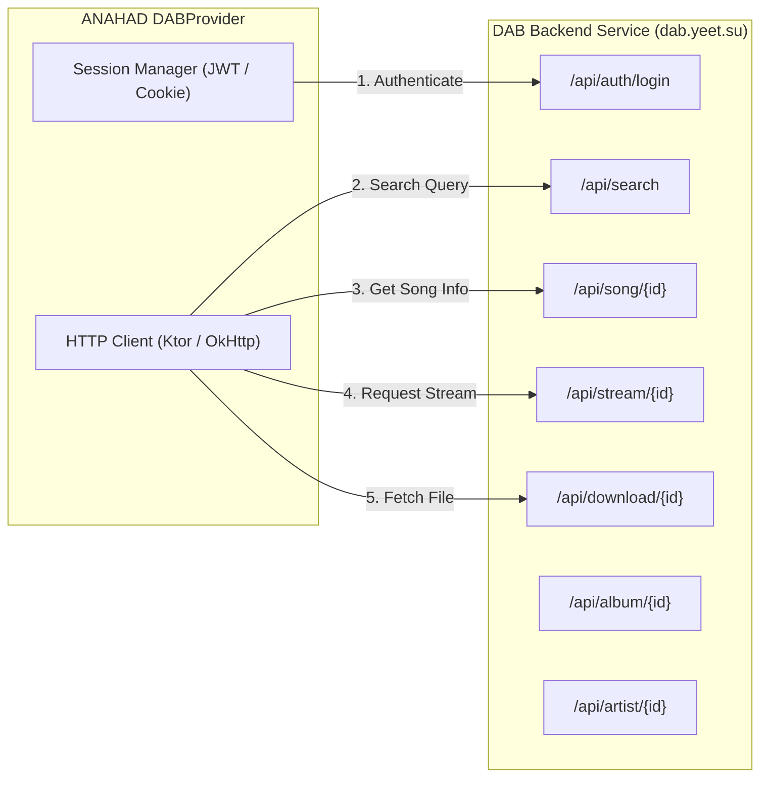

# ANAHAD: DAB Acquisition Provider Specification

- **Document Version**: 2.0.0
- **Status**: Complete Provider Specification & Availability Audit
- **Component**: DAB Acquisition Provider (`DABProvider`)
- **Ecosystem Reference**: DAB Music API (`dab.yeet.su` / `0xDABmusic` / `dab-downloader`)

---

## 1. Overview & Community Background

The **DAB Provider** was introduced in the previous ANAHAD Go backend to interface with the community-driven **DAB Music API** ecosystem (popularized by client tools such as `0xDABmusic`, `dab-downloader`, and the `KRTirtho/dab_music_api` Dart/OpenAPI specification).

### 1.1 Purpose & Role in ANAHAD
- **High-Fidelity Archive**: Provided direct streaming and downloading of studio-quality 16-bit and 24-bit FLAC files without requiring commercial streaming platform subscriptions.
- **Dedicated Session Management**: Utilized its own independent user registration and authentication manager to maintain authenticated sessions with the DAB backend.

---

## 2. API Architecture & Historical Endpoints

The DAB Music API follows a RESTful design. Community implementations and client specifications establish the following primary endpoints:



### 2.1 Historical Endpoint Audit & Parameter Mapping

#### 1. Authentication (`POST /api/auth/login`)
- **Headers**: `Content-Type: application/json`
- **Payload**:
  ```json
  {
    "username": "user@example.com",
    "password": "user_password"
  }
  ```
- **Response**: Sets an HTTP-only session cookie (or returns a Bearer JWT token in `access_token`).

#### 2. Search (`GET /api/search`)
- **Query Parameters**:
  - `q` (string, required): Search query string.
  - `type` (string, optional): `song`, `album`, `artist`, or `all`.
  - `page` (integer, optional): Page offset.
  - `limit` (integer, optional): Results count.
- **Response Schema**:
  ```json
  {
    "success": true,
    "data": {
      "songs": [
        {
          "id": "dab_song_91823",
          "title": "Cornfield Chase",
          "artist": "Hans Zimmer",
          "album": "Interstellar",
          "duration": 126,
          "has_flac": true,
          "bit_depth": 24,
          "sample_rate": 44100
        }
      ]
    }
  }
  ```

#### 3. Song Metadata Details (`GET /api/song`)
- **Query Parameter**: `id` (e.g. `/api/song?id=dab_song_91823`)
- **Response**: Full metadata, lyrics timestamps, cover art URL, and available bitrate formats.

#### 4. Audio Streaming (`GET /api/stream`)
- **Query Parameter**: `id` (e.g. `/api/stream?id=dab_song_91823`)
- **Headers**: Accepts `Range: bytes={start}-{end}` for seeking.
- **Response Headers**:
  - `Content-Type: audio/flac`
  - `Accept-Ranges: bytes`
  - `Content-Range: bytes {start}-{end}/{total}`
  - Status `206 Partial Content` on byte-range requests.

#### 5. Track Download (`GET /api/download`)
- **Query Parameter**: `id`
- **Response**: Direct binary FLAC attachment with `Content-Disposition: attachment; filename="..."`.

#### 6. Artist & Album Endpoints (`GET /api/artist`, `GET /api/album`)
- Returns discography, full album tracklists, and high-resolution album artwork.

---

## 3. Session Management Architecture

The DAB Provider relies on an independent session lifecycle manager (`DabSessionManager`):

```kotlin
package com.anahad.acquisition.provider.dab

class DabSessionManager(
    private val secureStorage: EncryptedStorage
) {
    private var cachedToken: String? = null
    private var sessionCookie: String? = null

    suspend fun login(username: String, password: String): Result<DabSession> {
        // Authenticate against /api/auth/login
        // Store JWT and session cookies in EncryptedSharedPreferences
    }

    fun getAuthHeaders(): Map<String, String> {
        val headers = mutableMapOf<String, String>()
        cachedToken?.let { headers["Authorization"] = "Bearer $it" }
        sessionCookie?.let { headers["Cookie"] = it }
        return headers
    }

    fun isSessionValid(): Boolean {
        // Validate token expiration timestamp
        return !cachedToken.isNullOrEmpty()
    }
}
```

---

## 4. Current Service Availability & Operational Status

An investigation into the current status of the primary DAB backend (`dab.yeet.su`) reveals severe infrastructure instability:

### 4.1 Observed Availability Barriers
1. **Adware Redirect Loops**: Browsing to `dab.yeet.su` frequently triggers aggressive monetization and adware redirect loops rather than serving the expected landing or registration page.
2. **Intermittent API Downtime**: The backend API endpoints frequently experience extended outages, HTTP 502/504 Bad Gateway errors, and unexpected DNS failures.
3. **Domain Filtering & Cloudflare Bans**: Several ISPs and Cloudflare edge rules periodically block or challenge the raw domain.
4. **Community Mirror Migration**: Community projects (`0xDABmusic`, `dab-downloader`) frequently rotate alternative backend mirrors and Vercel-hosted proxy layers to maintain partial connectivity.

### 4.2 Status Designation in ANAHAD
In compliance with the project guidelines:
- **Designation**: **CURRENTLY UNAVAILABLE / HIGHLY UNSTABLE**.
- **Preservation Policy**: The `DABProvider` interface abstraction and data parsing logic are **preserved in full** within ANAHAD's codebase.
- **Fail-Safe Behavior**: If the live service fails health checks or connection attempts, the provider immediately marks itself as `ProviderStatus.OFFLINE_UNAVAILABLE`.
- **No Silent Fallback**: The system reports an explicit error to the user:
  > *"DAB Music Service is currently offline or unreachable. Please verify server status or select an alternate acquisition provider."*

---

## 5. Architectural Implementation in ANAHAD

```kotlin
package com.anahad.acquisition.provider.dab

class DabProvider(
    private val sessionManager: DabSessionManager,
    private val client: DabHttpClient,
    private val serverBaseUrl: String = "https://dab.yeet.su"
) : IMusicProvider {

    override val id: String = "dab"
    override val displayName: String = "DAB Music Archive"

    override val supportedCapabilities: Set<ProviderCapability> = setOf(
        ProviderCapability.SEARCH,
        ProviderCapability.GET_TRACK_METADATA,
        ProviderCapability.GET_ALBUM_METADATA,
        ProviderCapability.GET_ARTIST_METADATA,
        ProviderCapability.STREAM_AUDIO,
        ProviderCapability.DOWNLOAD_AUDIO,
        ProviderCapability.LOSSLESS_FLAC_NATIVE,
        ProviderCapability.SESSION_AUTHENTICATION,
        ProviderCapability.RANGE_REQUESTS
    )

    override val status: ProviderStatus
        get() = when {
            !sessionManager.isSessionValid() -> ProviderStatus.REQUIRES_AUTHENTICATION
            else -> ProviderStatus.OFFLINE_UNAVAILABLE // Marked unavailable until live check succeeds
        }

    override suspend fun checkHealth(): ProviderHealth {
        return try {
            val response = client.get("$serverBaseUrl/api/health")
            if (response.isSuccessful) ProviderHealth.Healthy else ProviderHealth.Unreachable
        } catch (e: Exception) {
            ProviderHealth.Unreachable
        }
    }

    override suspend fun resolveDownload(
        trackId: String,
        preferredQuality: AudioQuality
    ): Result<DownloadDescriptor> {
        val health = checkHealth()
        if (health != ProviderHealth.Healthy) {
            return Result.failure(
                ProviderException.ServiceUnavailable(
                    "DAB backend at $serverBaseUrl is currently unavailable."
                )
            )
        }
        return client.getDownloadUrl(trackId, sessionManager.getAuthHeaders())
    }
}
```

---

## 6. Recommendations & Roadmap for DAB Provider

1. **Retain Provider Structure**: Keep all models, endpoint contracts, and session handling in the codebase.
2. **Configurable Base URL**: Allow advanced users to point the `DABProvider` to community mirror URLs or private self-hosted DAB API instances via Settings (`dab_custom_server_url`).
3. **Automated Health Probing**: Execute a lightweight `HEAD` or `/api/health` probe before presenting DAB in the provider selection list to prevent user frustration.
