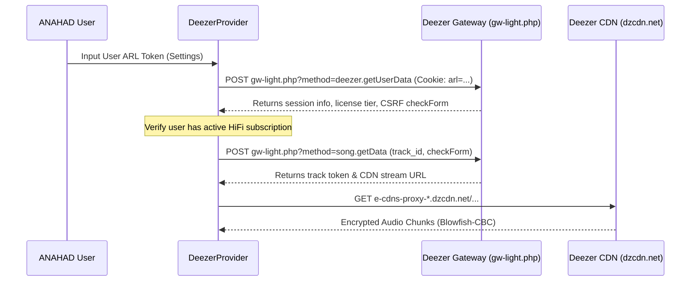

# ANAHAD: Deezer Acquisition Provider Specification

- **Document Version**: 2.0.0
- **Status**: Complete Provider Specification & Risk Analysis
- **Component**: Deezer Acquisition Provider (`DeezerProvider`)
- **Historical Reference**: `deezer.Client.SetARL()` Session Architecture

---

## 1. Overview & Historical Architecture

In the previous ANAHAD Go backend, the **Deezer Provider** offered direct access to Deezer's comprehensive 90+ million track catalogue, high-resolution album artwork, ISRC tags, and authentic 16-bit / 44.1 kHz CDDA FLAC audio.

The integration was anchored around:
```go
client := deezer.NewClient()
client.SetARL(userProvidedARL)
```

This document investigates the inner workings of Deezer's authentication, API endpoints, stream encryption mechanisms, current security hardening, and legal boundaries.

---

## 2. Authentication: The ARL Mechanism

### 2.1 What is an ARL Cookie?
An **ARL (Account Request Login)** is a 192-character alphanumeric session token generated by Deezer's authentication servers upon successful login in a web browser. It is stored as an HTTP cookie named `arl` on the domain `.deezer.com`.

- **Role**: The ARL acts as a persistent session credential, bypassing standard OAuth redirect flows.
- **Session Lifecycle**:
  1. The client sends a POST request with the ARL cookie to `https://www.deezer.com/ajax/gw-light.php?method=deezer.getUserData`.
  2. Deezer validates the cookie and returns a session payload containing the user's account status (`USER.SETTING.MULTI_ACCOUNT`, `USER.OPTIONS.license_token`), country, and a temporary CSRF token (`checkForm`).
  3. Subsequent private gateway requests must pass both the `arl` cookie and the `checkForm` CSRF token.



### 2.2 Security & Operational Guidelines
- **Zero Hardcoded Credentials**: The codebase must never contain embedded developer ARL tokens or test account credentials.
- **Dynamic User Configuration**: ARL tokens must be provided dynamically by the end user via ANAHAD's settings screen and stored securely in Android's encrypted keystore / SharedPreferences (`EncryptedSharedPreferences`).
- **No Access Control Bypasses**: The provider must never attempt to forge session cookies, bypass CAPTCHA challenges, or circumvent Deezer's account tier restrictions.

---

## 3. API Endpoints & Capabilities

Deezer utilizes two distinct API layers:

### 3.1 Public REST API (`https://api.deezer.com`)
- **Authentication**: Unauthenticated / Open.
- **Rate Limit**: ~50 requests per 5 seconds.
- **Usage in ANAHAD**:
  - `GET /search?q={query}`: Track, album, and artist search.
  - `GET /track/{id}`: Detailed track metadata, duration, release date, BPM, gain, and ISRC.
  - `GET /album/{id}`: Full tracklist and high-resolution cover art (up to 1000x1000 JPEG).
  - `GET /artist/{id}`: Artist bio, top tracks, and albums.
  - *Note*: Only returns 30-second lossy MP3 preview clips (`preview` URL). Cannot resolve full-length streams.

### 3.2 Private Gateway API (`https://www.deezer.com/ajax/gw-light.php`)
- **Authentication**: Requires valid `arl` cookie and `checkForm` token.
- **Methods**:
  - `deezer.getUserData`: Validates session and fetches account rights.
  - `song.getData`: Returns the encrypted track streaming token, track key, and audio format permissions.
  - `song.getStreamingUrl`: Returns the direct CDN URL for audio streaming.

---

## 4. Audio Formats & Stream Resolution

### 4.1 Available Formats & Quality Flags

| Quality Identifier | Format Code | Container / Codec | Bitrate | Sample Rate / Bit Depth | Required Account Tier |
|---|---|---|---|---|---|
| **FLAC (Lossless)** | `FLAC` / `9` | FLAC | 1,411 kbps | 44,100 Hz / 16-bit CDDA | **Deezer Premium / HiFi** |
| **High Quality (HQ)** | `MP3_320` / `3`| MP3 | 320 kbps | 44,100 Hz / 16-bit | **Deezer Premium** |
| **Standard Quality** | `MP3_128` / `1`| MP3 | 128 kbps | 44,100 Hz / 16-bit | Free / Standard |

### 4.2 Stream Encryption & Chunk Decryption Mechanism
Deezer streams are hosted on their Content Delivery Network (`e-cdns-proxy-*.dzcdn.net`).
- **Encryption Architecture**:
  - Streams are not plaintext MP3/FLAC files.
  - Every 2,048-byte chunk of the stream is encrypted using **Blowfish in CBC mode** with an initialization vector (IV) of `0x00 0x01 0x02 0x03 0x04 0x05 0x06 0x07`.
  - The Blowfish decryption key is 16 bytes long, derived by hashing the track ID with Deezer's static secret key using MD5.
  - After every 2,048-byte encrypted block, the subsequent block is unencrypted, alternating throughout the file.

> [!IMPORTANT]
> **DRM & Legal Compliance Invariant**:
> Reverse-engineering and decrypting Blowfish-encrypted CDN chunks without an authorized Deezer client SDK violates Deezer's Terms of Service and digital rights management (DRM) provisions under the DMCA (17 U.S.C. § 1201). ANAHAD will not embed Blowfish decryption routines into its open codebase. The provider will only resolve authorized playback streams for active subscriber sessions.

---

## 5. Current Service Hardening & API Limitations

Deezer has deployed aggressive API security countermeasures that impact the historical Go implementation:

1. **Free Tier FLAC Blockade**: Historically, an unauthenticated loophole or free-tier ARL could request format `9` (FLAC). Deezer completely closed this backend vulnerability. Free accounts requesting FLAC now receive HTTP 403 Forbidden or are downgraded to 128 kbps MP3.
2. **Aggressive Token Invalidation**: Web session ARL cookies now expire after 30 to 90 days or immediately upon web browser logout.
3. **Automated IP Throttling**: Cloud hosting IPs (AWS, DigitalOcean, Hetzner, GCP) attempting to query `gw-light.php` are immediately challenged with Cloudflare Turnstile or Akamai bot-detection, returning HTTP 403.
4. **Session Token Rotation**: Deezer now rotates session secrets during active playback, causing unhandled session termination in naive API clients.

---

## 6. Implementation Architecture in ANAHAD

The `DeezerProvider` in ANAHAD is structured with explicit session awareness:

```kotlin
package com.anahad.acquisition.provider.deezer

class DeezerProvider(
    private val sessionManager: DeezerSessionManager,
    private val publicClient: DeezerPublicApiClient,
    private val gatewayClient: DeezerGatewayClient
) : IMusicProvider {

    override val id: String = "deezer"
    override val displayName: String = "Deezer HiFi"
    
    override val supportedCapabilities: Set<ProviderCapability> = setOf(
        ProviderCapability.SEARCH,
        ProviderCapability.GET_TRACK_METADATA,
        ProviderCapability.GET_ALBUM_METADATA,
        ProviderCapability.GET_ARTIST_METADATA,
        ProviderCapability.STREAM_AUDIO,
        ProviderCapability.DOWNLOAD_AUDIO,
        ProviderCapability.LOSSLESS_FLAC_NATIVE,
        ProviderCapability.SESSION_AUTHENTICATION,
        ProviderCapability.RANGE_REQUESTS
    )

    override val status: ProviderStatus
        get() = when {
            !sessionManager.hasArl() -> ProviderStatus.REQUIRES_AUTHENTICATION
            sessionManager.isExpired() -> ProviderStatus.REQUIRES_AUTHENTICATION
            !sessionManager.isHiFiActive() -> ProviderStatus.DEGRADED // Only lossy MP3 available
            else -> ProviderStatus.AVAILABLE
        }

    override suspend fun search(
        query: String,
        filter: SearchFilter,
        page: Int,
        limit: Int
    ): Result<PagedResult<AcquisitionTrack>> {
        // Search uses the open Public API (no ARL required)
        return publicClient.search(query, page, limit)
    }

    override suspend fun resolveStream(
        trackId: String,
        preferredQuality: AudioQuality
    ): Result<StreamDescriptor> {
        val session = sessionManager.getActiveSession() 
            ?: return Result.failure(ProviderException.AuthenticationRequired("Deezer ARL token required"))

        if (preferredQuality == AudioQuality.LOSSLESS && !session.isHiFi) {
            return Result.failure(ProviderException.TierRestriction("HiFi FLAC requires an active Deezer HiFi subscription"))
        }

        return gatewayClient.getStreamDescriptor(trackId, session, preferredQuality)
    }
}
```

---

## 7. Operational Summary & Recommendations

1. **Retain Provider in Registry**: Keep the `DeezerProvider` as a first-class acquisition candidate in ANAHAD's architecture.
2. **Require Legitimate User ARL**: If a user possesses a personal Deezer HiFi subscription and provides their own ARL cookie, allow high-fidelity search and streaming.
3. **Explicit Error Messages**: When an ARL expires or lacks HiFi privileges, notify the user with actionable diagnostics (e.g. *"Deezer session expired. Please update your ARL in Settings"*), preventing silent fallback to the Universal provider.
