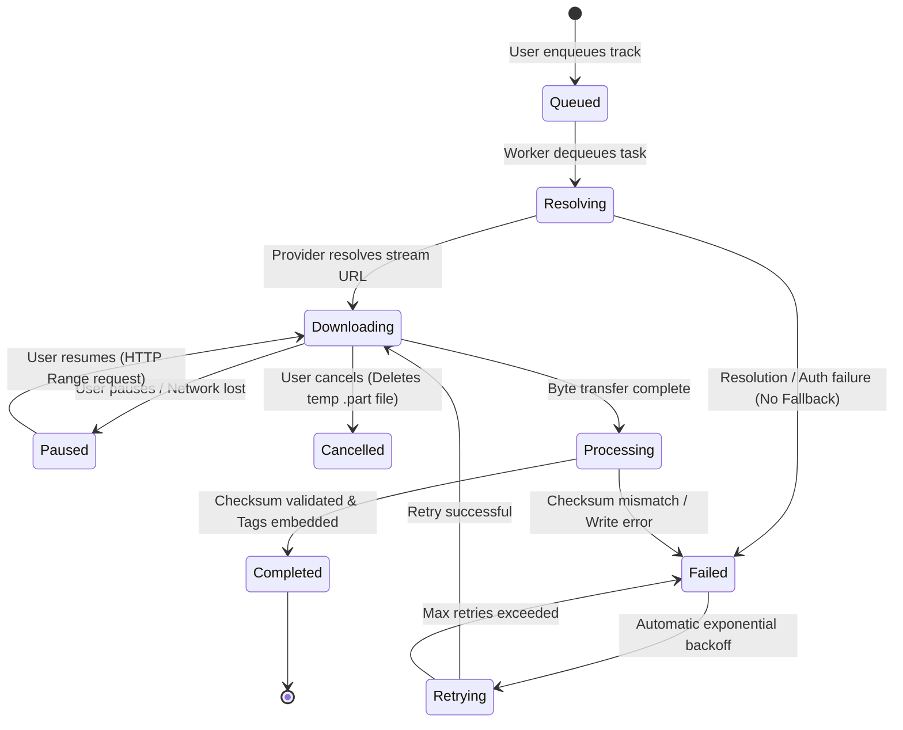

# ANAHAD: Resumable Download Manager & Storage Architecture

- **Document Version**: 2.0.0
- **Status**: Core Subsystem Architecture Specification
- **Component**: Download Manager (`AnahadDownloadManager`)
- **Target Platform**: Android (Kotlin, Coroutines, WorkManager, OkHttp, Room)

---

## 1. Architectural Mandate & Key Invariants

The **ANAHAD Download Manager** is responsible for orchestrating background file acquisitions across multiple providers while guaranteeing:
1. **Strict Provider Binding**: Every download task binds exclusively to the provider chosen at enqueue time. The manager **never silently switches providers** or falls back to an alternate engine upon failure.
2. **Provider-Specific Credential Preservation**: Provider sessions and authentication headers (e.g. Deezer ARL or DAB JWT) are injected cleanly into the respective download job without cross-provider leakage.
3. **Atomic File Safety**: Partial downloads are written to temporary staging files (`.part`). Files are renamed to their final destination only after successful transfer and checksum verification.
4. **Deduplication**: Avoids duplicate downloads through track-ID registry checks and content-hash comparisons.
5. **Lossless Metadata Preservation**: Embedded metadata, lyrics, and high-resolution album artwork are written into the local file container before the track is registered into the local library.



---

## 2. Preventing the Historical Dependency Injection Bug

### 2.1 The Previous Architecture Failure
In the deleted Go backend:
- The download manager received a generic `MusicProvider` interface injected into its worker pool.
- During provider resolution, fallback logic caught errors from Deezer/DAB and invoked a default provider factory.
- Because `UniversalProvider` was wired as the default singleton, failed Deezer/DAB requests silently morphed into `yt-dlp` YouTube downloads without user notification.

### 2.2 The ANAHAD Solution: Immutable Provider Binding
In the reconstructed architecture:
1. Every `DownloadTask` contains an immutable `providerId` string.
2. The download worker queries the `ProviderRegistry` for that exact `providerId`.
3. If that provider is unauthenticated or offline, the task transitions to `DownloadState.FAILED` with a descriptive error. It **never falls back**.

```kotlin
class DownloadExecutionWorker(
    private val registry: ProviderRegistry,
    private val storageManager: LocalStorageManager,
    private val httpClient: OkHttpClient
) {
    suspend fun executeTask(task: DownloadTask): DownloadResult {
        // Explicit provider lookup - throws exception if invalid
        val provider = registry.get(task.providerId)

        // Health check on the bound provider
        val status = provider.status
        if (status != ProviderStatus.AVAILABLE) {
            return DownloadResult.Failed(
                error = "Bound provider '${provider.displayName}' is currently $status. Silent fallback is prohibited."
            )
        }

        // Execute download strictly with bound provider
        val descriptor = provider.resolveDownload(task.trackId, task.preferredQuality)
            .getOrElse { error ->
                return DownloadResult.Failed("Resolution failed on ${provider.displayName}: ${error.message}")
            }

        return performHttpDownload(task, descriptor)
    }
}
```

---

## 3. Resumable Download Pipeline (RFC 7233)

### 3.1 Partial File Staging
All downloads write to a staging file using a deterministic naming convention:
```
/Music/ANAHAD/.staging/{task_uuid}.part
```

### 3.2 Resume Logic via HTTP Range Requests
When resuming an interrupted or paused download:
1. The manager inspects the existing byte length of `{task_uuid}.part`.
2. If `existingBytes > 0`, it adds an HTTP `Range` header:
   ```
   Range: bytes={existingBytes}-
   ```
3. The server must respond with `HTTP 206 Partial Content`.
4. If the server does not support ranges (returns `HTTP 200 OK`), the manager truncates the `.part` file to `0` and restarts cleanly to prevent file corruption.

```kotlin
private suspend fun performHttpDownload(
    task: DownloadTask,
    descriptor: DownloadDescriptor
): DownloadResult {
    val stagingFile = storageManager.getStagingFile(task.id)
    val existingLength = if (stagingFile.exists()) stagingFile.length() else 0L

    val requestBuilder = Request.Builder()
        .url(descriptor.downloadUri)
        .apply {
            descriptor.headers.forEach { (k, v) -> addHeader(k, v) }
            if (existingLength > 0 && descriptor.supportsRangeRequests) {
                addHeader("Range", "bytes=$existingLength-")
            }
        }

    val response = httpClient.newCall(requestBuilder.build()).execute()
    
    // Validate response code: 206 for range resume, 200 for fresh download
    if (response.code != 200 && response.code != 206) {
        return DownloadResult.Failed("HTTP error ${response.code}: ${response.message}")
    }

    val append = (response.code == 206)
    val outputStream = FileOutputStream(stagingFile, append)

    // Stream chunks with cancellation support and speed tracking
    response.body?.byteStream()?.use { input ->
        val buffer = ByteArray(32 * 1024)
        var bytesRead: Int
        var totalDownloaded = if (append) existingLength else 0L

        while (input.read(buffer).also { bytesRead = it } != -1) {
            if (task.isCancelled()) {
                outputStream.close()
                stagingFile.delete()
                return DownloadResult.Cancelled
            }
            outputStream.write(buffer, 0, bytesRead)
            totalDownloaded += bytesRead
            task.updateProgress(totalDownloaded, descriptor.fileSizeBytes)
        }
    }
    outputStream.flush()
    outputStream.close()

    return verifyAndCommit(task, stagingFile, descriptor)
}
```

---

## 4. Checksum Verification & Atomic Commitment

### 4.1 Integrity Validation
Before moving the file into the active music library:
1. **Checksum Verification**:
   - If `descriptor.expectedChecksumSha256` or `expectedChecksumMd5` is provided, compute the hash of the downloaded `.part` file.
   - If the computed hash does not match, the file is rejected and deleted to prevent audio corruption.
2. **Container Validation**:
   - Check the file magic header (`fLaC`, `OggS`, or `ftypM4A`) to verify container validity.

### 4.2 Metadata & Artwork Tagging
Before moving to the final directory:
- Write Vorbis comments (`TITLE`, `ARTIST`, `ALBUM`, `DATE`, `ISRC`, `GENRE`).
- Embed front album artwork directly into the FLAC `METADATA_BLOCK_PICTURE`.
- If the track was converted from Opus/AAC, embed the mandatory provenance tag:
  ```
  ANAHAD_TRANSCODED=true
  ANAHAD_SOURCE_PROVIDER=universal
  ```

### 4.3 Atomic File Rename
```kotlin
fun commitFile(task: DownloadTask, stagingFile: File, sanitizedFileName: String): File {
    val destinationDir = storageManager.getUserMusicDirectory()
    val finalFile = File(destinationDir, "$sanitizedFileName.flac")
    
    // Atomic filesystem move
    if (!stagingFile.renameTo(finalFile)) {
        // Fallback to NIO atomic copy if cross-filesystem
        Files.move(stagingFile.toPath(), finalFile.toPath(), StandardCopyOption.ATOMIC_MOVE)
    }
    
    // Trigger Android MediaStore indexer
    MediaScannerConnection.scanFile(context, arrayOf(finalFile.absolutePath), null, null)
    return finalFile
}
```

---

## 5. Deduplication & Conflict Resolution

To avoid redundant downloads and storage waste:

1. **Track-ID Pre-Check**: Before enqueuing, the database queries `local_tracks` for existing records matching `source_provider` and `source_id`.
2. **Destination File Collision Handling**: If a file named `Shankar Mahadevan - Breathless.flac` already exists in `/Music/ANAHAD/`:
   - Compute the hash of the existing file.
   - If the existing file matches the target checksum, mark the download immediately as `Completed` without re-downloading.
   - If it is a different track with an identical name, append the track ID: `Shankar Mahadevan - Breathless [trk_01h8x].flac`.

---

## 6. Android OS Integration

| Requirement | Android Architecture Strategy |
|---|---|
| **Background Execution** | Android Jetpack `WorkManager` with `ForegroundInfo` and `Expedited` execution constraints. |
| **Notification Controls** | Ongoing notification showing progress bar, download speed (MB/s), and Pause / Cancel action buttons. |
| **Storage Permissions** | Android 13+ (API 33+) granular media permissions (`READ_MEDIA_AUDIO`); Storage Access Framework (SAF) for user-selected custom directories. |
| **Network Constraints** | User preference for *"Download on Wi-Fi Only"*, enforced via `NetworkType.UNMETERED` WorkManager constraints. |
