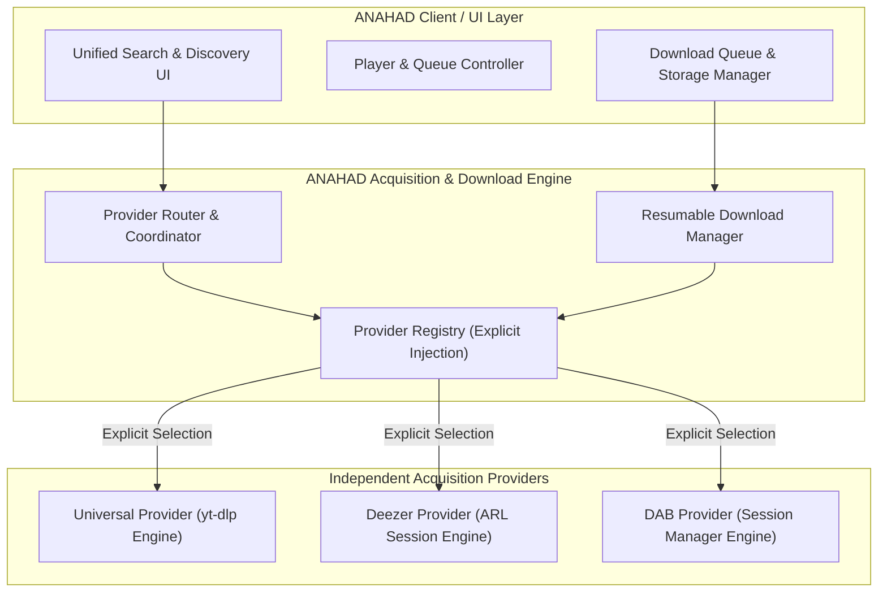
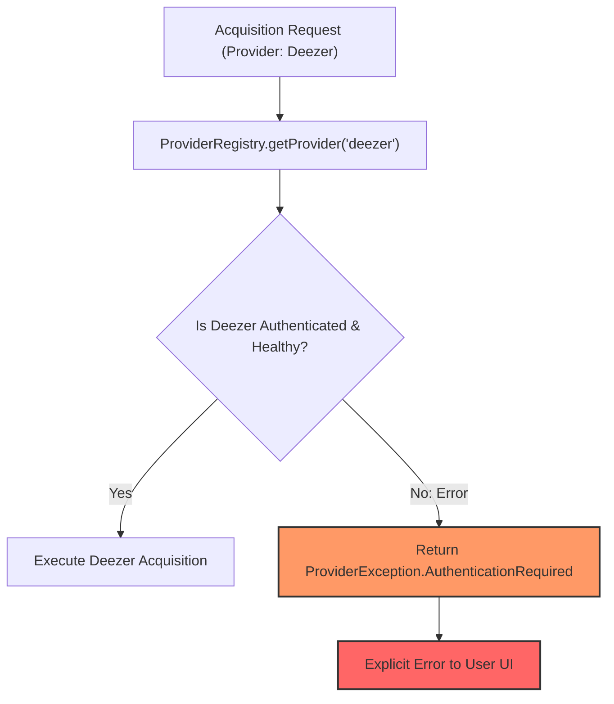

# ANAHAD: Unified Music Provider Architecture

- **Document Version**: 2.0.0
- **Status**: Core Architecture Specification
- **Evaluating System**: ANAHAD Senior Engineering Architecture (Ponytail)
- **Target Platform**: Android & Go Backend / Kotlin Multiplatform Core

---

## 1. Architectural Philosophy & Objectives

The ANAHAD music acquisition subsystem is designed to support **multi-provider audio discovery, resolution, and acquisition** while maintaining strict boundaries between:
1. Core playback engine.
2. Local library and storage management.
3. Remote provider-specific protocols.

### 1.1 The Three Supported Acquisition Providers
Rather than coupling the system to a single catalog or replacing previous implementations with generic creative-commons repositories, ANAHAD reconstructs and unifies the three acquisition providers from the previous ANAHAD Go architecture:

1. **Universal Provider**: Multi-source extraction engine powered by `yt-dlp` for expansive search, stream extraction, and format conversion across 1,000+ online media platforms.
2. **Deezer Provider**: Commercial catalog integration using Deezer's metadata and private gateway with user-provided session ARL authentication (`deezer.Client.SetARL()`).
3. **DAB Provider**: High-fidelity community archive client interfacing with the DAB Music API (`dab.yeet.su` / `0xDABmusic`) via JWT session management.



---

## 2. Core Provider Interface Contract

Each provider implements a common interface abstraction, but **only advertises and executes the capabilities it natively supports**. The system never assumes every provider can perform streaming, lossless downloads, or authenticated search.

### 2.1 Provider Capabilities Bitmask / Set
```kotlin
package com.anahad.acquisition.model

enum class ProviderCapability {
    SEARCH,                 // Can search tracks via text query
    GET_TRACK_METADATA,     // Can fetch comprehensive metadata for track ID
    GET_ALBUM_METADATA,     // Can fetch album tracklists and artwork
    GET_ARTIST_METADATA,    // Can fetch artist discography
    STREAM_AUDIO,           // Can resolve direct progressive streaming URLs
    DOWNLOAD_AUDIO,         // Can perform offline file downloading
    LOSSLESS_FLAC_NATIVE,   // Delivers authentic lossless FLAC (not converted)
    SESSION_AUTHENTICATION, // Requires/supports user login or session tokens
    RANGE_REQUESTS          // Streaming/download supports HTTP Range seeks
}
```

### 2.2 The Unified Provider Port (`IMusicProvider`)
```kotlin
package com.anahad.acquisition.port

import com.anahad.acquisition.model.*
import kotlinx.coroutines.flow.Flow

interface IMusicProvider {
    val id: String                          // "universal", "deezer", "dab"
    val displayName: String                 // "Universal Engine", "Deezer", "DAB"
    val supportedCapabilities: Set<ProviderCapability>
    val status: ProviderStatus

    // Capability-checked operations:
    suspend fun search(
        query: String,
        filter: SearchFilter = SearchFilter.ALL,
        page: Int = 1,
        limit: Int = 25
    ): Result<PagedResult<AcquisitionTrack>>

    suspend fun getTrackMetadata(trackId: String): Result<AcquisitionTrack>
    
    suspend fun getAlbumMetadata(albumId: String): Result<AcquisitionAlbum>
    
    suspend fun getArtistMetadata(artistId: String): Result<AcquisitionArtist>

    suspend fun resolveStream(
        trackId: String,
        preferredQuality: AudioQuality = AudioQuality.LOSSLESS
    ): Result<StreamDescriptor>

    suspend fun resolveDownload(
        trackId: String,
        preferredQuality: AudioQuality = AudioQuality.LOSSLESS
    ): Result<DownloadDescriptor>

    suspend fun authenticate(credentials: ProviderCredentials): Result<AuthenticationResult>
    
    suspend fun checkHealth(): ProviderHealth
}

enum class ProviderStatus {
    AVAILABLE,
    REQUIRES_AUTHENTICATION,
    DEGRADED,
    OFFLINE_UNAVAILABLE
}
```

---

## 3. Provenance Tracking & Data Models

Every single search result, stream descriptor, and downloaded file is tagged with its originating `providerId`. This ensures the UI can inform the user of the exact source and fidelity of each track.

### 3.1 AcquisitionTrack Model
```kotlin
package com.anahad.acquisition.model

data class AcquisitionTrack(
    val id: String,                     // Format: "{provider_id}:{provider_track_id}"
    val providerId: String,             // "universal", "deezer", "dab"
    val title: String,
    val artist: String,
    val album: String,
    val durationMs: Long,
    val artworkUrl: String?,
    val isrc: String? = null,
    val releaseYear: Int? = null,
    val audioProfile: ProviderAudioProfile,
    val rawMetadata: Map<String, Any> = emptyMap()
)

data class ProviderAudioProfile(
    val format: String,                 // "flac", "opus", "aac", "mp3"
    val bitDepth: Int? = null,          // 16 or 24
    val sampleRateHz: Int? = null,      // e.g. 44100, 48000, 96000
    val bitrateKbps: Int? = null,       // e.g. 320, 1411
    val isLosslessSource: Boolean,      // TRUE only if source is genuine uncompressed/lossless
    val isTranscodedContainer: Boolean  // TRUE if converted from a lossy source (e.g. Opus -> FLAC)
)
```

---

## 4. Solving the Historical Dependency Injection Bug

### 4.1 Root Cause of the Previous Architecture Flaw
In the previous Go backend, a dependency-injection flaw occurred in the service initialization wireup:
- The `UniversalProvider` was registered as the fallback handler in the acquisition router.
- When `DeezerProvider` or `DABProvider` encountered an unauthenticated state, expired session, or rate limit, the service container silently defaulted to the `UniversalProvider` without propagating the error.
- As a consequence, requests configured for high-resolution Deezer/DAB FLAC downloads were silently routed to YouTube through `yt-dlp`, resulting in 160 kbps Opus audio being converted to FLAC containers without user consent.

### 4.2 The Explicit Selection Solution
ANAHAD enforces strict, non-fallback provider resolution:



1. **No Silent Fallback**: If a requested provider fails or lacks credentials, the system immediately returns an explicit `ProviderError` (e.g. `ProviderError.SessionExpired`, `ProviderError.ServiceUnavailable`).
2. **Explicit Provider Registry**:
   ```kotlin
   class ProviderRegistry(
       private val providers: Map<String, IMusicProvider>
   ) {
       fun get(providerId: String): IMusicProvider {
           return providers[providerId] 
               ?: throw NoSuchProviderException("Provider '$providerId' is not registered.")
       }

       fun getOrNull(providerId: String): IMusicProvider? = providers[providerId]

       fun getAll(): List<IMusicProvider> = providers.values.toList()
   }
   ```
3. **Download Task Binding**: When a download is enqueued, the `providerId` is permanently serialized into the download record. The download manager binds strictly to that specific provider instance and will fail the job rather than re-route it to an alternate engine.

---

## 5. Architectural Capability Comparison

| Capability | Universal Provider | Deezer Provider | DAB Provider |
|---|---|---|---|
| **Underlying Engine** | `yt-dlp` CLI & Core Library | Unofficial Deezer API & Gateway | DAB REST API (`dab.yeet.su`) |
| **Authentication** | None (Cookies optional for YT) | User ARL Cookie (`SetARL()`) | User JWT / Session Cookie |
| **Search Breadth** | 1,000+ sites (YouTube, SC, Bandcamp) | Official Deezer 90M+ track catalog | Curated lossless music archive |
| **Native FLAC Available** | Bandcamp only (Rare elsewhere) | Yes (16-bit / 44.1 kHz via HiFi ARL) | Yes (16-bit & 24-bit FLAC) |
| **Converted FLAC Support** | Yes (Opus/AAC $\to$ FLAC via FFmpeg) | Not applicable | Not applicable |
| **Lossless Source Quality** | Lossy by default; True on Bandcamp | Authentic CDDA Lossless (HiFi) | Authentic Lossless / Hi-Res |
| **Streaming Latency** | Low to Moderate (Direct CDN) | Low (Deezer Akamai CDN) | High / Unstable (Server bandwidth) |
| **Seeking Support** | Yes (RFC 7233 byte ranges) | Yes (Chunked streams) | Yes (HTTP Range) |
| **Current Live Status** | **Fully Functional** | **Restricted (Requires HiFi ARL)** | **Unavailable / High Instability** |

---

## 6. Implementation Architecture Next Steps
1. Reconstruct the **Universal Provider** specification with explicit `isTranscodedContainer` guards (`docs/UNIVERSAL_PROVIDER.md`).
2. Document the **Deezer Provider** architecture, reverse-engineering ARL session handling, chunk decryption requirements, and policy constraints (`docs/DEEZER_PROVIDER.md`).
3. Formally specify the **DAB Provider** endpoints, session management, and state of service availability (`docs/DAB_PROVIDER.md`).
4. Detail the **Download Manager** state machine, failure isolation, deduplication, and atomic storage commit pipeline (`docs/DOWNLOAD_MANAGER.md`).
5. Synthesize complete verification records in `docs/MUSIC_SOURCE_VERIFICATION.md`.
