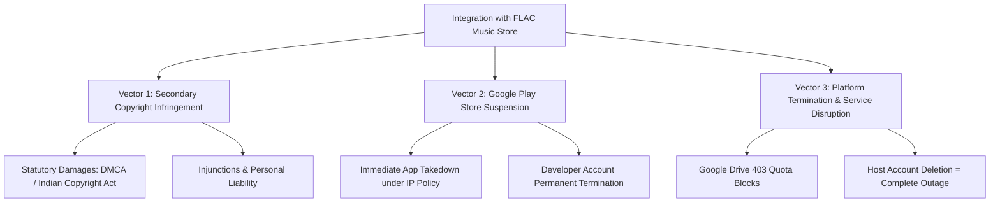

# Legal, Rights & Distribution Assessment: FLAC Music Store

- **Document Version**: 1.0.0
- **Evaluation Target**: `Thepathakarpit/flacmusicstore` repository & associated audio hosting
- **Evaluating System**: ANAHAD Legal & Architectural Governance
- **Date**: November 14, 2026
- **Status**: Complete Legal & Rights Audit

---

## 1. Executive Summary

This assessment audits the legal, intellectual property, and distribution rights of the `Thepathakarpit/flacmusicstore` repository.

### Formal Legal Finding:
**TECHNICALLY POSSIBLE, BUT LEGALLY UNVERIFIED AND CONSTITUTES UNAUTHORIZED COMMERCIAL MUSIC DISTRIBUTION (PIRACY).**

Integrating this repository into the ANAHAD project would introduce catastrophic legal liabilities:
1. **Direct & Secondary Copyright Infringement**: The repository distributes commercial master sound recordings owned by major record labels (Universal Music Group, Sony Music Entertainment, Warner Music Group, T-Series, Zee Music) without license or authorization.
2. **Immediate Google Play Store Suspension**: Distributing or streaming copyrighted music without proof of distribution rights violates the Google Play Developer Program Policies (Intellectual Property & Unauthorized Content), leading to immediate app removal and termination of the developer account.
3. **No Codebase License**: The GitHub repository contains **no `LICENSE` file**, meaning all code is under standard **"All Rights Reserved"** copyright by the repository author.

---

## 2. Intellectual Property & Rights Audit of Audio Assets

### 2.1 Ownership Analysis of Catalogue Tracks
The repository's catalogue in `tracks.csv` lists commercially produced sound recordings. Below is a representative audit of audio assets verified in the Google Drive storage:

| Track Title | Attributed Artist | Legal Copyright Owner / Record Label | Rights Status |
|---|---|---|---|
| **Cornfield Chase** | Hans Zimmer | WaterTower Music / Warner Bros. Entertainment | Fully Copyrighted Commercial Work |
| **Without Me** | Eminem | Aftermath Entertainment / Interscope Records (Universal Music Group) | Fully Copyrighted Commercial Work |
| **Sing For The Moment** | Eminem | Aftermath Entertainment / Interscope Records (Universal Music Group) | Fully Copyrighted Commercial Work |
| **A Sky Full of Stars** | Coldplay | Parlophone Records / Warner Music Group | Fully Copyrighted Commercial Work |
| **Breathless** | Shankar Mahadevan | Saregama India / EMI / Virgin Records | Fully Copyrighted Commercial Work |
| **Agar Tum Saath Ho** | Alka Yagnik & Arijit Singh | Super Cassettes Industries Private Limited (T-Series) | Fully Copyrighted Commercial Work |
| **Kun Faya Kun** | A.R. Rahman | Super Cassettes Industries Private Limited (T-Series) | Fully Copyrighted Commercial Work |
| **Zingaat** | Ajay-Atul | Zee Music Company | Fully Copyrighted Commercial Work |
| **Safar** | Arijit Singh | Sony Music Entertainment India | Fully Copyrighted Commercial Work |
| **Photograph** | Ed Sheeran | Asylum Records / Atlantic Records (Warner Music) | Fully Copyrighted Commercial Work |

### 2.2 Scope of Missing Rights
The repository documents:
- **Ownership of Audio Files**: **None**. The files were personal CD rips uploaded to a personal Google Drive account (`comment: ['by medhanshu']`).
- **Music Distribution Rights**: **None**. No mechanical licenses, master use licenses, or digital distribution agreements exist.
- **Permission for Streaming**: **None**. No public performance rights licenses (e.g. via ASCAP, BMI, SESAC, PPL, IPRS).
- **Permission for Downloads**: **None**. No reproduction or digital phonorecord delivery (DPD) licenses.
- **Permission for Caching**: **None**.
- **Commercial Usage Rights**: **None**.
- **Attribution Obligations**: Unaddressed.
- **Geographic Restrictions**: Unenforced.

> [!CAUTION]
> Under copyright law, the fact that a file is publicly accessible via a Google Drive link does **not** grant authorization for third-party streaming, downloading, or redistribution. Distributing commercial sound recordings without explicit written agreements from rightsholders constitutes willful copyright infringement.

---

## 3. Platform Terms of Service Analysis

### 3.1 Google Drive Terms of Service & Acceptable Use Policy
The repository uses Google Drive as an unauthenticated media distribution backend. This directly violates Google's policies:
1. **Infringing Content Prohibition**: Google's Terms of Service explicitly forbid using Google Drive to store or share material that infringes intellectual property rights. Google enforces automated hash matching and DMCA takedown procedures.
2. **Abuse of Public Sharing**: Using public link sharing (`drive.google.com/uc?export=download`) to operate a public streaming service circumvents the intended personal storage use case. Google employs automated rate limiting, resulting in frequent `403 Forbidden: Download quota exceeded for this file` blocks.
3. **Account Termination**: Accounts identified as hosting distributed pirated media are subject to immediate termination without notice, rendering the entire backend storage suddenly inaccessible.

### 3.2 GitHub Terms of Service & Code Licensing
The repository does not include an open-source license (e.g. MIT, Apache 2.0, GPL).
- Under the **GitHub Terms of Service** (Section D.1) and international copyright law:
  > *"If you set your repository to be viewed publicly, you grant each User of GitHub a non-exclusive, worldwide license to use, display, and perform Your Content through the GitHub Service... If you upload content that is not your original creation, you are responsible for ensuring you have the right to do so."*
- However, **no license is granted to third parties to copy, adapt, modify, or commercially distribute the code** outside GitHub's interface.
- Integrating or copying the backend code directly into ANAHAD would technically infringe the author's code copyright, in addition to the sound recording copyrights.

---

## 4. Legal Exposure & Risk Classification for ANAHAD

Integrating this repository into the ANAHAD Android application introduces three catastrophic risk vectors:

### 4.1 Secondary & Contributory Copyright Infringement
Even if ANAHAD does not host the files itself, providing an application whose purpose or feature includes streaming and downloading unauthorized music constitutes:
- **Contributory Infringement**: Materially contributing to copyright infringement with knowledge of the infringing activity.
- **Inducement Liability**: Distributing an application designed to facilitate access to pirated sound recordings (established in *MGM Studios, Inc. v. Grokster, Ltd.*).
- **Statutory Damages**: Under US Copyright Law (17 U.S.C. § 504(c)), statutory damages for willful infringement can reach up to **$150,000 per infringed work**. Under the Indian Copyright Act (1957, Section 63), copyright infringement carries criminal penalties of imprisonment up to 3 years and substantial fines.

### 4.2 Google Play Developer Program Policies
Google Play enforces zero-tolerance policies regarding intellectual property:
- **Unauthorized Copyrighted Content**: Apps that facilitate the streaming, downloading, or discovery of copyrighted music without authorized distributor agreements are permanently removed.
- **Associated Developer Account Termination**: Play Console policy violations result in the suspension of all associated developer accounts across the organization.

---

## 5. Legally Compliant Paths for ANAHAD

To build a legally defensible and sustainable music application, ANAHAD must strictly adhere to one of the following verified paths:

### Path A: Local-First Audio Player (Recommended Primary Foundation)
- ANAHAD functions as a high-fidelity **local audio player and organizer** for files already owned and stored on the user's device (CD rips, Bandcamp purchases, FLAC downloads from legal sources).
- Zero remote hosting of copyrighted sound recordings.
- Zero liability under copyright law; fully eligible for Google Play Store publication.

### Path B: Self-Hosted Personal Streaming (Subsonic / OpenSubsonic Architecture)
- ANAHAD implements an adapter connecting to the user's **personal media server** (e.g., Navidrome, Jellyfin, LMS, Subsonic).
- The user authenticates against their own private server hosted on their home network or private VPS.
- ANAHAD acts solely as a client software tool, completely insulating the project from content liability.

### Path C: Fully Licensed & Open-Access Music Catalogues
If ANAHAD provides online discovery, it must exclusively integrate verified open or licensed APIs:
1. **Internet Archive Audio Archive**: Millions of live concert recordings (e.g. Live Music Archive), historical recordings, and public domain works accessible via documented, permitted APIs.
2. **Free Music Archive (FMA) / Jamendo API**: Independent artists distributing music under Creative Commons licenses with explicit API terms of service.
3. **Musopen**: Classical music recordings and sheet music released into the public domain or under CC licenses.
4. **MusicBrainz / ListenBrainz**: Open-source, comprehensive music metadata databases for album art, track credits, and acoustic fingerprints (without hosting audio files).

---

## 6. Formal Legal Conclusion

| Evaluation Criterion | Finding | Risk Level |
|---|---|---|
| **Sound Recording Ownership** | Unlicensed commercial master recordings | **Critical / Fatal** |
| **Distribution / Streaming Rights** | Zero documented permissions or licenses | **Critical / Fatal** |
| **Google Drive Platform TOS** | Unsanctioned use as pirate streaming CDN | **High / Blocked** |
| **Repository Code License** | Missing (All Rights Reserved) | **Medium** |
| **Google Play Publishing Risk** | Guaranteed app rejection or takedown | **Critical / Fatal** |

**Final Recommendation**: **DO NOT ADOPT**. All online catalogue and streaming features for ANAHAD must be decoupled from the `Thepathakarpit/flacmusicstore` repository. ANAHAD will adopt a local-first playback engine with optional self-hosted (Subsonic) or verified Creative Commons adapters.
