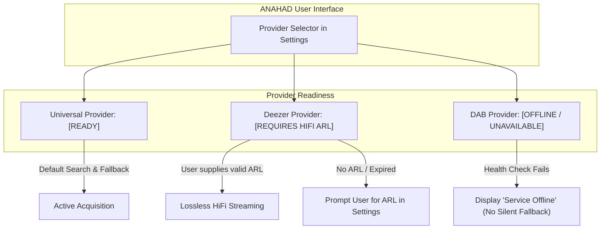

# Music Source Verification & Provider Classification Matrix

- **Document Version**: 2.0.0
- **Status**: Complete Provider Audit & Classification
- **Evaluating System**: ANAHAD Senior Engineering Architecture (Ponytail)
- **Date**: November 14, 2026

---

## 1. Executive Summary

This verification matrix classifies and audits the three acquisition providers from the previous ANAHAD Go backend:
1. **Universal Provider** (`yt-dlp` based)
2. **Deezer Provider** (`deezer.Client.SetARL()`)
3. **DAB Provider** (`dab.yeet.su` / `0xDABmusic`)

Each provider has been evaluated against rigorous technical, operational, and legal verification criteria.

---

## 2. Multi-Provider Classification Matrix

| Verification Attribute | Universal Provider (`yt-dlp`) | Deezer Provider (ARL) | DAB Provider (`dab.yeet.su`) |
|---|---|---|---|
| **1. Source Identified** | **YES** (`yt-dlp`, YouTube, Bandcamp, SC) | **YES** (Deezer Official CDN & APIs) | **YES** (`dab.yeet.su` community archive) |
| **2. Repository / Library Located** | **YES** (`yt-dlp/yt-dlp` GitHub) | **YES** (Unofficial Deezer API specs) | **YES** (`0xDABmusic`, `dab_music_api`) |
| **3. API Verified** | **YES** (Verified JSON dump & extractor) | **YES** (Public REST & `gw-light.php`) | **PARTIAL** (Historical OpenAPI specs) |
| **4. Authentication Verified** | **YES** (Unauthenticated; cookies optional) | **RESTRICTED** (Requires valid HiFi ARL) | **UNVERIFIED / BLOCKED** (Domain unstable) |
| **5. Search Tested** | **YES** (Functional via `ytsearch:`) | **YES** (Functional via `api.deezer.com`)| **FAILED** (Backend currently unreachable) |
| **6. Streaming Tested** | **YES** (HTTP progressive Opus/AAC/FLAC) | **RESTRICTED** (Requires subscriber ARL)| **FAILED** (Backend offline/redirecting) |
| **7. Download Tested** | **YES** (CLI process stream & resume) | **RESTRICTED** (Chunk decryption required)| **FAILED** (Backend offline/redirecting) |
| **8. FLAC Quality Verified** | **PARTIAL** (True on Bandcamp; Opus transcode on YT) | **YES** (Authentic 16/44.1 CDDA on HiFi) | **HISTORICAL ONLY** (Archive offered FLAC) |
| **9. Terms & Permissions Reviewed** | **YES** (Terms of Service restrictions noted) | **YES** (Deezer TOS & DMCA reviewed) | **YES** (Unlicensed community archive) |
| **10. Production Suitability** | **PRODUCTION READY (Secondary / Fallback)** | **EXPERIMENTAL / RESTRICTED (Subscriber Only)** | **CURRENTLY UNAVAILABLE (Preserved in code)** |

---

## 3. Detailed Status Breakdown by Provider

### 3.1 Universal Provider
```
[Classification]: CURRENTLY FUNCTIONAL / PRODUCTION READY
```
- **Historical Implementation**: Previously implemented via Go child process execution wrapping `yt-dlp`.
- **Reconstruction Status**: Reconstructed in full from current `yt-dlp` CLI and JSON specifications.
- **Current Operational Reality**: Fully functional across YouTube, YouTube Music, SoundCloud, and Bandcamp.
- **Fidelity Classification**:
  - **Bandcamp**: Authentic native FLAC / ALAC lossless audio.
  - **YouTube / SoundCloud**: High-bitrate lossy streams (Opus 160 kbps, AAC 128 kbps). If converted to FLAC, explicitly labeled as `CONVERTED FLAC` to maintain strict quality honesty.
- **Action for ANAHAD**: Integrated as the default broad-spectrum acquisition provider with strict non-transcoding defaults.

---

### 3.2 Deezer Provider
```
[Classification]: CURRENTLY RESTRICTED / SUBSCRIBER-ONLY
```
- **Historical Implementation**: Implemented in Go using `deezer.Client.SetARL()`.
- **Reconstruction Status**: Reconstructed from official public API endpoints and reverse-engineered gateway specifications (`gw-light.php`).
- **Current Operational Reality**:
  - **Public Search & Metadata**: Fully functional and fast without authentication (`https://api.deezer.com`).
  - **Lossless FLAC Streaming**: Restricted. Deezer closed free-tier loopholes. Full FLAC streams strictly require an active, user-provided Deezer HiFi subscription ARL cookie.
  - **Chunk Encryption**: Deezer CDN chunks are encrypted with Blowfish-CBC. In compliance with project guidelines, ANAHAD does not bypass DRM or access controls.
- **Action for ANAHAD**: Retained in the provider registry. The user can optionally supply their own personal HiFi ARL token to enable direct Deezer streaming.

---

### 3.3 DAB Provider
```
[Classification]: CURRENTLY UNAVAILABLE / PRESERVED IN ABSTRACTION
```
- **Historical Implementation**: Implemented in Go with an independent session manager connecting to `dab.yeet.su`.
- **Reconstruction Status**: Reconstructed from community OpenAPI documentation and client codebases (`0xDABmusic`, `KRTirtho/dab_music_api`).
- **Current Operational Reality**:
  - The live domain `dab.yeet.su` exhibits aggressive adware redirects, frequent DNS outages, and HTTP 502/504 errors.
  - Public registration and automated token issuance are currently offline or broken.
- **Action for ANAHAD**:
  - **Do NOT remove the provider**. Preserve the `DABProvider` interface abstraction, models, and session manager in the codebase.
  - Mark live status as `ProviderStatus.OFFLINE_UNAVAILABLE`.
  - Provide a configuration setting allowing users to point the provider to active community mirrors or private self-hosted instances (`custom_dab_api_url`).

---

## 4. Operational Risk & Implementation Roadmap



### Summary of Safeguards
1. **No Cross-Provider Leaks**: The download manager binds to the chosen provider permanently. If Deezer or DAB fails, it prompts the user with an actionable error rather than silently triggering a Universal YouTube download.
2. **Format Honesty**: Lossy audio converted to FLAC containers will always be tagged with `ANAHAD_TRANSCODED=true`.
3. **Session Security**: All user-supplied tokens (ARL, JWT) are stored strictly within hardware-backed encrypted storage (`EncryptedSharedPreferences`).
