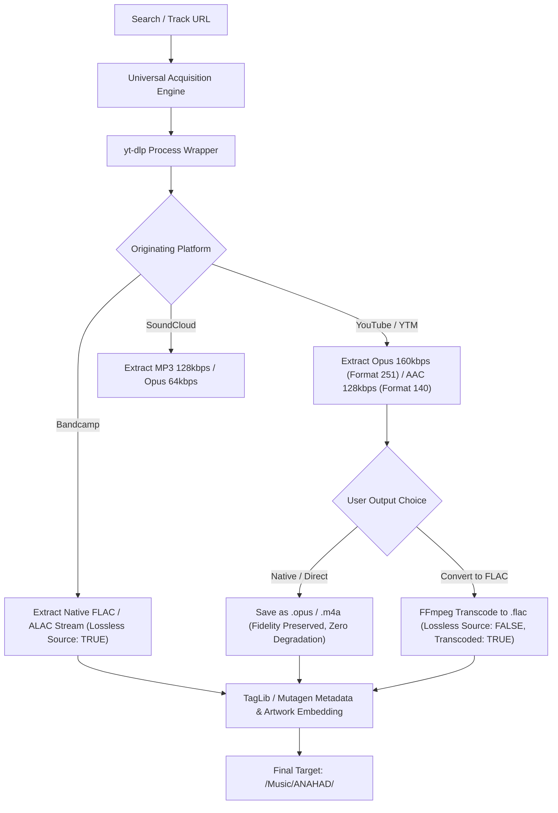

# ANAHAD: Universal Acquisition Provider Specification

- **Document Version**: 2.0.0
- **Status**: Complete Engine Specification
- **Component**: Universal Acquisition Engine (`UniversalProvider`)
- **Core Technology**: `yt-dlp` Core Integration & FFmpeg Processing Pipeline

---

## 1. Architectural Role & Overview

The **Universal Provider** serves as ANAHAD's broad-spectrum media acquisition engine. It abstracts over `yt-dlp` to query, resolve, stream, and download audio from over 1,000 online media sources (including YouTube, YouTube Music, SoundCloud, Bandcamp, Mixcloud, and internet radio).

### 1.1 Core Principles
1. **Source Transparency**: The engine must clearly inform the user of the originating source domain and original audio codec.
2. **Lossless vs. Converted Distinction**: The engine strictly enforces the distinction between **native lossless FLAC** (e.g. from Bandcamp) and **converted FLAC** (e.g. YouTube Opus audio transcoded into a `.flac` container). Under no circumstances will converted lossy audio be labeled as "Original Lossless".



---

## 2. Supported Source Types & Capabilities

| Platform | Search Prefix | Stream Codec | Native Bitrate / Sample Rate | True Lossless Available? | Transcode Needed for FLAC? |
|---|---|---|---|---|---|
| **YouTube Music** | `ytsearch:` | Opus (format 251) / AAC (140) | ~160 kbps / 48 kHz (Opus) | **No** (Lossy web streaming) | Yes (Converted only) |
| **YouTube** | `ytsearch:` | Opus (format 251) / AAC (140) | ~160 kbps / 48 kHz (Opus) | **No** (Lossy web streaming) | Yes (Converted only) |
| **Bandcamp** | Direct URL / search | FLAC / ALAC / MP3 320 | Up to 24-bit / 96 kHz FLAC | **Yes** (Creator lossless upload) | No (Direct FLAC stream) |
| **SoundCloud** | `scsearch:` | Opus / MP3 | 64 kbps Opus / 128 kbps MP3 | **No** (Standard web streams) | Yes (Converted only) |
| **Direct HTTP / HLS** | URL | AAC / MP3 / FLAC | Variable | **Depends on Source** | Depends on Source |

---

## 3. Search & Track Resolution

### 3.1 Search Implementation
The Universal Engine invokes `yt-dlp` in non-downloading extraction mode using JSON output streams:

```bash
yt-dlp \
  --default-search "ytsearch10" \
  --dump-single-json \
  --flat-playlist \
  --no-warnings \
  --ignore-errors \
  "ytsearch10:Shankar Mahadevan Breathless"
```

#### JSON Response Normalization
The engine parses the stdout JSON and constructs normalized `AcquisitionTrack` instances:
```kotlin
fun parseYtDlpJson(json: JsonObject): AcquisitionTrack {
    val durationSec = json["duration"]?.jsonPrimitive?.longOrNull ?: 0L
    val id = json["id"]?.jsonPrimitive?.content ?: ""
    val extractor = json["extractor_key"]?.jsonPrimitive?.content ?: "youtube"
    
    return AcquisitionTrack(
        id = "universal:$extractor:$id",
        providerId = "universal",
        title = json["title"]?.jsonPrimitive?.content ?: "Unknown Title",
        artist = json["uploader"]?.jsonPrimitive?.content ?: "Unknown Artist",
        album = json["album"]?.jsonPrimitive?.content ?: "Unknown Album",
        durationMs = durationSec * 1000,
        artworkUrl = json["thumbnail"]?.jsonPrimitive?.content,
        audioProfile = ProviderAudioProfile(
            format = "opus",
            sampleRateHz = 48000,
            bitrateKbps = 160,
            isLosslessSource = false,
            isTranscodedContainer = false
        )
    )
}
```

### 3.2 Format Selection Strategy
When resolving a track for playback or download, the engine applies a deterministic format selector string:

```
# Best native audio (Opus preferred for YouTube, FLAC preferred for Bandcamp)
bestaudio[acodec=flac]/bestaudio[acodec=alac]/bestaudio[acodec=opus]/bestaudio[ext=m4a]/bestaudio
```

1. **Bandcamp / Direct FLAC**: If an uncompressed stream (`acodec=flac` or `acodec=alac`) is present, it is selected directly. `isLosslessSource` is marked `TRUE`.
2. **YouTube / SoundCloud**: The highest-bitrate lossy stream (Opus 160kbps or AAC 128kbps) is selected. `isLosslessSource` is marked `FALSE`.

---

## 4. Preservation of Source Fidelity vs. Converted Audio

A critical requirement in ANAHAD is eliminating false labeling of lossy audio transcoded into FLAC:

### 4.1 Strict Audio Quality Rules
1. **Never Transcode Silently**: If the source audio is Opus 160 kbps, the default behavior of the download manager is to save it in its native Opus container (`.opus`) or remux without re-encoding to an MP4/M4A container (`.m4a`). This maintains 100% of the acoustic quality with zero generational loss.
2. **User-Requested FLAC Conversion**: If the user explicitly selects *"Convert to FLAC container"*:
   - The engine invokes FFmpeg:
     ```bash
     ffmpeg -i input.webm -c:a flac -sample_fmt s16 output.flac
     ```
   - The engine writes explicit Vorbis metadata tags:
     ```
     COMMENT=Converted from YouTube Opus (160 kbps) by ANAHAD
     ANAHAD_SOURCE_CODEC=opus
     ANAHAD_IS_TRANSCODED=true
     ```
   - The ANAHAD UI displays:
     ```
     [CONVERTED FLAC (Opus Source 160kbps)]
     ```
     rather than a misleading *"Hi-Res Lossless"* badge.

---

## 5. Download Execution & Process Lifecycle

### 5.1 Process Wrapper Architecture
The Universal Provider executes `yt-dlp` as an external child process (via Go `os/exec` or Android process bridge):

```kotlin
class YtDlpProcessWrapper(
    private val ytDlpBinaryPath: String,
    private val ffmpegBinaryPath: String
) {
    fun download(
        url: String,
        targetDirectory: File,
        convertToFlac: Boolean,
        onProgress: (DownloadProgress) -> Unit,
        cancellationSignal: AtomicBoolean
    ): DownloadResult {
        val tempFile = File(targetDirectory, "${UUID.randomUUID()}.part")
        
        val args = mutableListOf(
            ytDlpBinaryPath,
            "--newline",
            "--continue",
            "--ffmpeg-location", ffmpegBinaryPath,
            "-f", "bestaudio",
            "-o", tempFile.absolutePath,
            url
        )

        if (convertToFlac) {
            args.addAll(listOf("-x", "--audio-format", "flac"))
        }

        val process = ProcessBuilder(args)
            .redirectErrorStream(true)
            .start()

        // Read stdout line-by-line for progress regex matching
        val reader = process.inputStream.bufferedReader()
        var line: String?
        while (reader.readLine().also { line = it } != null) {
            if (cancellationSignal.get()) {
                process.destroyForcibly()
                tempFile.delete()
                return DownloadResult.Cancelled
            }
            parseProgress(line)?.let { onProgress(it) }
        }

        val exitCode = process.waitFor()
        return if (exitCode == 0) {
            DownloadResult.Success(tempFile)
        } else {
            DownloadResult.Failed("yt-dlp exited with error code $exitCode")
        }
    }
}
```

### 5.2 Progress & Status Parsing
`yt-dlp` progress output lines match the pattern:
```
[download]  42.5% of 15.20MiB at 3.12MiB/s ETA 00:03
```
The regex parser captures:
- `percentage`: `42.5`
- `totalSize`: `15.20 MiB`
- `speed`: `3.12 MiB/s`
- `eta`: `00:03` (3 seconds)

---

## 6. Error Handling & Edge Cases

| Error Condition | Cause | Universal Engine Recovery Strategy |
|---|---|---|
| **HTTP 429 Too Many Requests** | YouTube IP-level rate limiting | Exponential backoff; prompt user to attach `cookies.txt` from browser session. |
| **HTTP 403 Forbidden on Chunk** | Expired signed CDN token | Clear extractor cache; refresh stream manifest and resume download from last byte. |
| **Bot Detection (Sign-in required)** | Google `n-sig` challenge failure | Trigger automatic update check for `yt-dlp` binary; surface explicit error dialog to user. |
| **DRM-Protected Stream** | Widevine / FairPlay encryption | Gracefully fail immediately with `ProviderError.DrmProtectedContent`. Never attempt decryption. |
| **Geo-restricted Track** | Content unavailable in user region | Return `ProviderError.GeoRestricted` with platform country code. |

---

## 7. Operational Recommendations for ANAHAD
1. **Native Container Default**: Always default to downloading in the native source codec (`.opus` / `.m4a`) to avoid unnecessary disk bloat and re-encoding overhead.
2. **Auto-Update Mechanism**: Maintain an automatic weekly check for `yt-dlp` binary updates to prevent YouTube extractor breakage.
3. **Bandcamp Priority for FLAC**: When the user searches specifically for lossless tracks, prioritize Bandcamp source extractors over YouTube.
