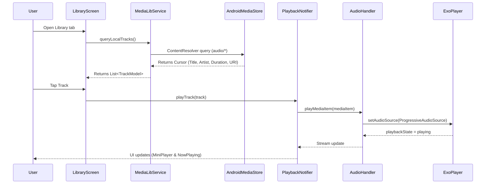
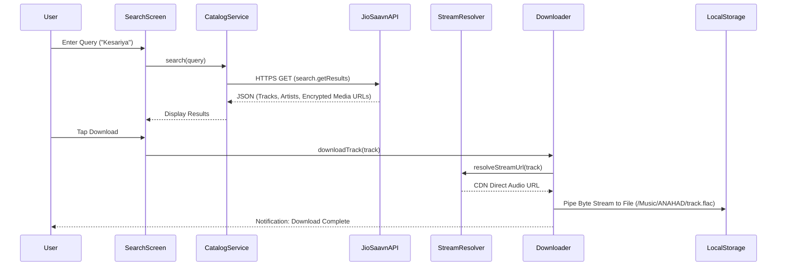

# ANAHAD | Data Flow Architecture

This document describes the flow of data through ANAHAD across local storage, playback, and network operations.

---

## 1. Local Music Playback Data Flow

---

## 2. Online Search & Streaming Data Flow

---

## 3. Synchronized Lyrics Retrieval Flow

1. When a track begins playback, `PlaybackNotifier._loadLyricsForCurrentItem` triggers.
2. `LyricsService` sanitizes title and artist strings (stripping parenthetical movie credits or remastered tags).
3. First checks local device storage for a matching `.lrc` file in the download directory.
4. If missing locally, issues an HTTPS GET request to LRCLIB (`https://lrclib.net/api/get`).
5. If LRCLIB returns 404, issues a secondary search query to LRCLIB (`/api/search`).
6. If still unverified, falls back to JioSaavn lyric endpoint (`lyrics.getLyrics`).
7. Parses raw text into `List<LyricsLine>` with millisecond timestamps and notifies the UI.
