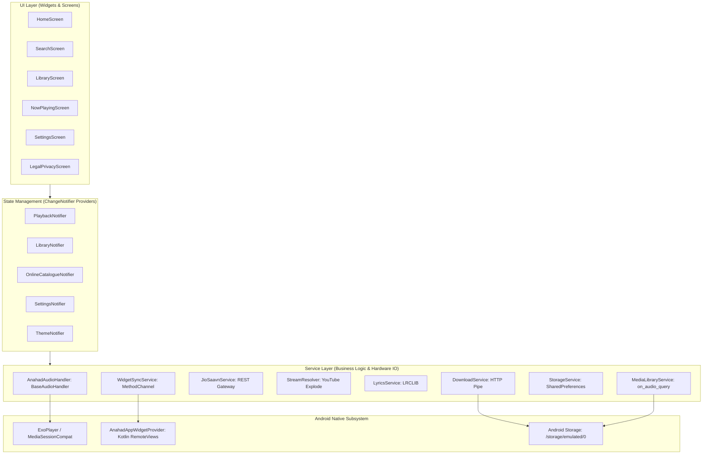

# ANAHAD | Technical Architecture & System Design

- **Architecture Pattern**: Provider-based Reactive MVVM with Service Layer Isolation
- **Runtime Environment**: Flutter Framework (Dart) + Native Android Subsystem (Kotlin)
- **Audio Decoding**: ExoPlayer via `just_audio`

---

## 1. Architectural Overview

---

## 2. Core Subsystems

### 2.1 Audio Playback Subsystem
- `AnahadAudioHandler`: Extends `audio_service.BaseAudioHandler`. Exposes streams for `playbackState`, `mediaItem`, and `queue`. Interacts with Android's system `MediaBrowserService` and `MediaSessionCompat`.
- `just_audio.AudioPlayer`: Manages audio decoding, buffering, loop modes, volume, and playback state machine transitions.
- Stream Resolution: Resolves playback URLs dynamically. If primary CDN URLs fail or expire, `StreamResolver` transparently activates YouTube Explode fallback to maintain uninterrupted playback.

### 2.2 Storage & Persistence Subsystem
- `StorageService`: Centralized manager for persistent keys using `SharedPreferences`. Stores playlists, favorites, download destination paths, search queries, and audio engine preferences.
- JSON Serialization: Playlists and favorites serialize cleanly into structured JSON dictionaries, facilitating zero-loss backup export and import.

### 2.3 Widget Synchronization Subsystem
- `WidgetSyncService`: Communicates across Flutter-to-Android boundary via `MethodChannel('com.anahad.audio/widget')`.
- Downsamples remote album art to <= 128px before transmitting to `AnahadAppWidgetProvider` to prevent Android `TransactionTooLargeException` in `RemoteViews`.
