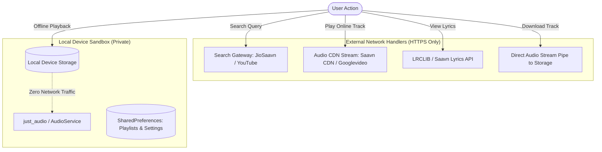

# ANAHAD | Data Inventory & Data Flow Map

- **Document Version**: 1.0.0
- **Application Target**: ANAHAD Music Player (Android)
- **Scope**: Complete Data Processing, Storage, Transmission, and Privacy Audit
- **Status**: Verified by Privacy and Data Protection Specialist
- **Last Updated**: November 2026

---

## 1. Executive Privacy Summary

ANAHAD is designed around strict **local-first and privacy-by-design principles**. 

- **Zero Telemetry**: No analytics SDKs, tracking pixels, crash reporting daemons, or device fingerprinting libraries are included in the build.
- **Zero User Profiling**: ANAHAD does not require account creation, login, phone number, email address, or third-party authentication.
- **Client-Side Processing**: Playlists, favorites, playback history, equalizer presets, and application configurations are stored exclusively on the user's local device.
- **Explicit Content Requests**: External network requests are initiated only in direct response to user actions (searching for a track, playing an online stream, downloading a song, or fetching lyrics/artwork).

---

## 2. Comprehensive Data-Flow Table

The following table categorizes all data processed, stored, or transmitted by ANAHAD:

| Data Category | Collected? | Purpose | Storage Location | Third-Party Sharing | Retention Period |
|---|---|---|---|---|---|
| **Local Audio Files** | Yes (Read-Only) | Discovered via `on_audio_query` to populate the offline Device Library and play user media. | User's local file system (`/storage/emulated/0/...`). Unmodified by app. | **None**. Never uploaded or transmitted. | Persists until deleted by user outside or inside the app. |
| **Downloaded Music Files** | Yes (Created by User) | Stored FLAC, AAC, or MP3 audio streams requested by the user for offline listening. | Local app storage or user-selected folder (`/Music/ANAHAD` or `/Download/ANAHAD`). | **None**. Kept locally on device. | Retained until deleted by the user. |
| **Search Queries** | Yes (Transient Transmission) | User-entered text queries to discover songs, albums, and artists online. | Outbound HTTPS GET query parameter. Recent queries stored in local `SharedPreferences`. | Transmitted directly to content search endpoints (JioSaavn public gateway, YouTube Explode). | In-app history retained until cleared by user. Server logs subject to respective endpoints' retention. |
| **Synchronized Lyrics (.lrc)** | Yes (Transient Retrieval) | Fetching time-stamped lyrics for the currently playing track via title and artist lookup. | Stored in memory during playback; optionally saved as local `.lrc` alongside downloaded files. | Transmitted to LRCLIB (`lrclib.net`) and JioSaavn lyrics API. | Retained locally with saved tracks or discarded on queue clear. |
| **Album Artwork** | Yes (Cached) | Fetching track cover images from CDN for visual display in UI, notification shade, and widget. | Cached locally on device via `flutter_cache_manager` in temporary app cache directory. | Retrieved from public CDNs (`aac.saavncdn.com`, `i.ytimg.com`). No user data sent. | Auto-cleared by OS or app cache management policies. |
| **Playlists & Favorites** | Yes (Local Only) | Organizing user collections, custom playlists, and favorite track lists. | Local device storage (`SharedPreferences` / JSON). | **None**. Never synchronized to remote servers or cloud databases. | Retained until modified/deleted by user or app uninstalled. |
| **Search History** | Yes (Local Only) | Displaying recent searches on the search screen for user convenience. | Local device storage (`SharedPreferences`). | **None**. Never uploaded. | Retained until manually cleared in UI or app data cleared. |
| **App Settings & Preferences** | Yes (Local Only) | Theme selection (Dark/AMOLED/Light), accent color, audio engine badges, download destination. | Local device storage (`SharedPreferences`). | **None**. | Retained until app uninstalled or data cleared. |
| **Backup Archives** | Yes (User-Initiated) | Exporting user configuration, playlists, and favorites to JSON for migration. | Generated to clipboard or user-selected file destination. | **None**. Transferred only wherever the user pastes or exports it. | Managed entirely by user. |
| **Device Identifiers (IMEI, MAC, Android ID)** | **NO** | Not required and not accessed. | Not stored. | **None**. | N/A |
| **Location Data (GPS, Network)** | **NO** | Not required and not requested. | Not stored. | **None**. | N/A |
| **Contact List & Account Info** | **NO** | Not required and not requested. | Not stored. | **None**. | N/A |
| **Crash Reports & Telemetry** | **NO** | No telemetry libraries (Firebase, Sentry, Bugsnag) bundled. | Local Android logcat only if developer attaches adb. | **None**. | N/A |
| **Advertising Identifiers (AAID)** | **NO** | No ad networks or mediation SDKs included. | Not stored. | **None**. | N/A |

---

## 3. Network Communication Architecture

ANAHAD communicates with external servers under strictly user-directed conditions:

### 3.1 Network Security Profile
- All outgoing network traffic uses TLS/HTTPS (`https://`).
- No plain HTTP cleartext traffic is permitted in production builds.
- No user tokens, credentials, cookies, or authentication secrets are exchanged.
- Outbound headers only include standard application user-agents (`User-Agent: ANAHAD/1.0.0`) necessary for standard REST protocol operation.

---

## 4. Third-Party Endpoint Analysis

| Service / Provider | Domain / Endpoint | Role in ANAHAD | Transmitted Data | Privacy Implication |
|---|---|---|---|---|
| **JioSaavn Gateway** | `saavn.me` / `jiosaavn.com` | Catalogue search, artist/album metadata, stream URL resolution. | Search keywords, album/artist/song IDs. | No personally identifiable user information sent. IP address visible to hosting CDN. |
| **YouTube (via YouTube Explode)** | `youtube.com` / `googlevideo.com` | Audio stream acquisition and playback resolution for search fallback. | Search queries, video IDs, byte-range stream requests. | Standard HTTP client request. IP address processed according to Google privacy policies. |
| **LRCLIB** | `lrclib.net` | Synchronized and plain text lyrics retrieval. | Track title, artist name, album name, duration. | Anonymous search parameters. No user telemetry. |
| **Audio & Art CDNs** | `aac.saavncdn.com`, `i.ytimg.com` | Content Delivery Networks serving binary audio streams and JPEG/PNG art. | Standard GET request with HTTP Range header. | Standard CDN edge logging of IP and user-agent. |

---

## 5. Privacy Compliance Summary

1. **Digital Personal Data Protection Act (DPDP), 2023 (India)**:
   - ANAHAD processes no personal data on behalf of any data fiduciary; all personal media and listening preferences remain solely on the data principal's hardware.
   - For ephemeral search queries, no personal identifier is associated with the query.
2. **General Data Protection Regulation (GDPR) (EU)**:
   - Does not collect or store personal data of EU residents.
   - Respects right of erasure: all data can be cleared immediately by clearing app storage in Android settings or deleting the app.
3. **Children's Online Privacy Protection Act (COPPA) & California Consumer Privacy Act (CCPA)**:
   - Does not collect personal information from any user, including children under 13 or California residents.
   - Zero sale or sharing of user personal data.
