# ANAHAD | LinkedIn Launch & Showcase Package

- **Product**: ANAHAD (अनहद) — Hi-Res Lossless Music Player for Android
- **Author**: [Your Name / Product Creator]
- **Target Audience**: Software Engineers, Product Managers, Mobile Developers, Audiophiles, Tech Founders, Design Enthusiasts

---

## 1. Primary LinkedIn Launch Post (Copy & Paste Ready)

```markdown
Most music streaming apps today feel like ad networks masquerading as media players.

Between invasive tracking, mandatory account walls, compressed 128kbps lossy audio, and clunky interfaces that treat your own local music library like an afterthought, I felt modern audio apps had lost their soul.

I wanted something different. Something that felt like the minimalist elegance of Apple Music, had the deep regional language discovery of Gaana, the raw sound-engineering fidelity of Poweramp, and an uncompromising stance on personal privacy.

So I built it: Meet **ANAHAD (अनहद)** — a high-resolution lossless music player for Android.

Here is what ANAHAD does:
True Lossless Playback: Native decoding for FLAC, ALAC, and WAV with dynamic audiophile format badges (24-bit / 96kHz and 192kHz).
Privacy-by-Design: ZERO telemetry, ZERO tracking SDKs, ZERO ads, and NO user accounts. Your listening habits stay on your device.
Indian Regional Music Hubs: Instant discovery across 12 languages with native typography (Hindi, Punjabi, Gujarati, Marathi, Rajasthani, Telugu, Tamil, and more).
Synchronized Karaoke Lyrics: Real-time time-stamped LRC lyrics with tap-to-seek playback.
Air Shuffle: A context-aware global shuffle engine that adapts intelligently whether you're in your offline library, searching, or exploring regional genres.
Native Android Widget & Background Audio: Full lock-screen and home-screen controls with live album art and lyrics sync.

How I Built It with AI:
I developed ANAHAD using AI-assisted development tools as high-velocity engineering collaborators. 
While AI accelerated boilerplate generation, architectural documentation, and API research, the real product ownership remained deeply human:
- Defining the product philosophy and audio engineering requirements.
- Designing the obsidian dark UI hierarchy, cyan neon glow, and tactile ergonomics.
- Establishing the strict zero-telemetry privacy boundary and legal compliance under India's DPDP Act 2023.
- Relentlessly testing, debugging native Android platform channels, fixing audio lifecycle crashes, and validating playback on physical devices.

What Building This Taught Me:
1. AI doesn't replace product thinking; it amplifies it. You still need strong architectural discipline, taste, and rigorous validation.
2. Modern Android media services (MediaSessionCompat, foreground playback, AppWidgets) require careful lifecycle management—there are no shortcuts to rock-solid stability.
3. True privacy in mobile apps is a deliberate design choice, not an accident.

ANAHAD is now open-source and ready for community testing. 

GitHub Repository: [Insert GitHub URL - https://github.com/username/anahad]
Download Release APK: [Insert Direct Download Link / Release Asset URL]

I would love your feedback on the audio pipeline, UX, and performance. If you are an audiophile, Android dev, or music lover, give it a spin and let me know what you think!

#AndroidDev #Flutter #MobileDevelopment #OpenSource #ProductDesign #Audiophile #BuildInPublic #AIInSoftware #PrivacyFirst #IndianMusic
```

---

## 2. One-Line Tagline & Short Descriptions

- **One-Line Tagline**:  
  *"ANAHAD: The audiophile, zero-telemetry Android music player celebrating high-resolution sound and Indian regional music."*
- **Short Product Description (50 words)**:  
  *ANAHAD is an independent, open-source Android audio player combining studio-grade lossless FLAC playback, synchronized karaoke lyrics, and 12 Indian regional language music hubs with an uncompromising privacy-first, zero-telemetry architecture. No accounts, no ads, just pure music.*
- **GitHub Repository Description (About Section)**:  
  *Audiophile, zero-telemetry Android music player built with Flutter. Native FLAC/Hi-Res playback, synchronized lyrics, Indian regional language hubs, and home screen widget.*

---

## 3. Three LinkedIn Headline Options

1. **Option 1 (Product & Tech Focus)**:  
   `Building ANAHAD: How I engineered a privacy-first, Hi-Res Android music player with Flutter & AI-assisted development.`
2. **Option 2 (Audiophile & Problem-Solving Focus)**:  
   `Tired of ads and compressed audio? I built an open-source, zero-telemetry music player for audiophiles and regional Indian music lovers.`
3. **Option 3 (Leadership & Modern Engineering Focus)**:  
   `From product vision to release APK: Lessons learned developing ANAHAD with AI-assisted software engineering.`

---

## 4. Product Demo Video / Carousel Storyboard

```mermaid
graph LR
    S1["Slide 1: Hook<br/>The Problem with Modern Streaming"] --> S2["Slide 2: Solution<br/>Introducing ANAHAD"]
    S2 --> S3["Slide 3: High-Res Audio<br/>FLAC & 24B/96kHz Badges"]
    S3 --> S4["Slide 4: Regional Music<br/>12 Language Hubs"]
    S4 --> S5["Slide 5: Live Karaoke Lyrics<br/>Tap-to-Seek Demo"]
    S5 --> S6["Slide 6: Zero Telemetry<br/>Local-First Architecture"]
    S6 --> S7["Slide 7: Widget & Lock-Screen<br/>Native Android Polish"]
    S7 --> S8["Slide 8: Call to Action<br/>GitHub & APK Download"]
```



| Frame | Visual / Screenshot | Headline / Caption |
|---|---|---|
| **Frame 1** | Compressed audio icons vs Hi-Res Gold/Cyan Badge | "Why settle for compressed 128kbps audio and ads?" |
| **Frame 2** | Full-screen Now Playing screen with neon cyan glow | "Meet ANAHAD: Pure audio fidelity meets Apple-inspired design." |
| **Frame 3** | AudioFormatBadge closeup (`HI-RES LOSSLESS • 24B/96.0kHz`) | "Studio Sound: Real-time lossless audio inspection." |
| **Frame 4** | Home Screen showing Hindi, Gujarati, Marathi, Punjabi tiles | "Indian Music Heritage: 12 regional languages at your fingertips." |
| **Frame 5** | Lyrics view with glowing active line | "Synchronized Karaoke Lyrics: Tap any line to seek instantly." |
| **Frame 6** | `Settings → About ANAHAD → Legal & Privacy` view | "100% Private: No accounts, no tracking SDKs, zero data collection." |
| **Frame 7** | Android Home Screen showing custom ANAHAD Widget | "Native Android Polish: Live widget and lock-screen media controls." |
| **Frame 8** | GitHub logo + APK Download Mockup | "Open Source & Free: Try the release APK today on GitHub." |

---

## 5. Screenshot Capture Checklist (For Post Attachments)

1. **`01_home_screen.png`**: Home view displaying the glowing header brand icon, regional language tiles (Hindi, Gujarati, Marathi, etc.), and trending carousel.
2. **`02_now_playing.png`**: Now playing screen with blurred artwork backdrop, cyan `HI-RES LOSSLESS` badge, seekbar, and transport buttons.
3. **`03_karaoke_lyrics.png`**: Now playing lyrics tab showing synchronized text with active timestamp highlighted in bold cyan.
4. **`04_language_hub.png`**: Regional language view (e.g., Gujarati / Marathi) showing curated songs and Air Shuffle button.
5. **`05_search_history.png`**: Search screen displaying recent search queries chips and clean result cards.
6. **`06_home_widget.png`**: Android device home screen showing the native ANAHAD widget actively playing with live artwork.
7. **`07_privacy_settings.png`**: In-app Legal & Privacy screen proving offline transparency and zero telemetry.
